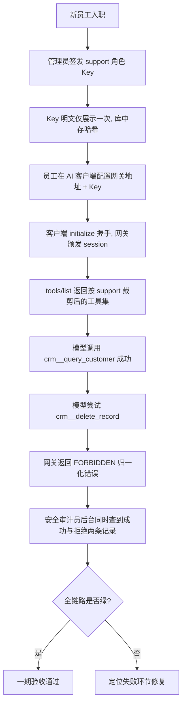
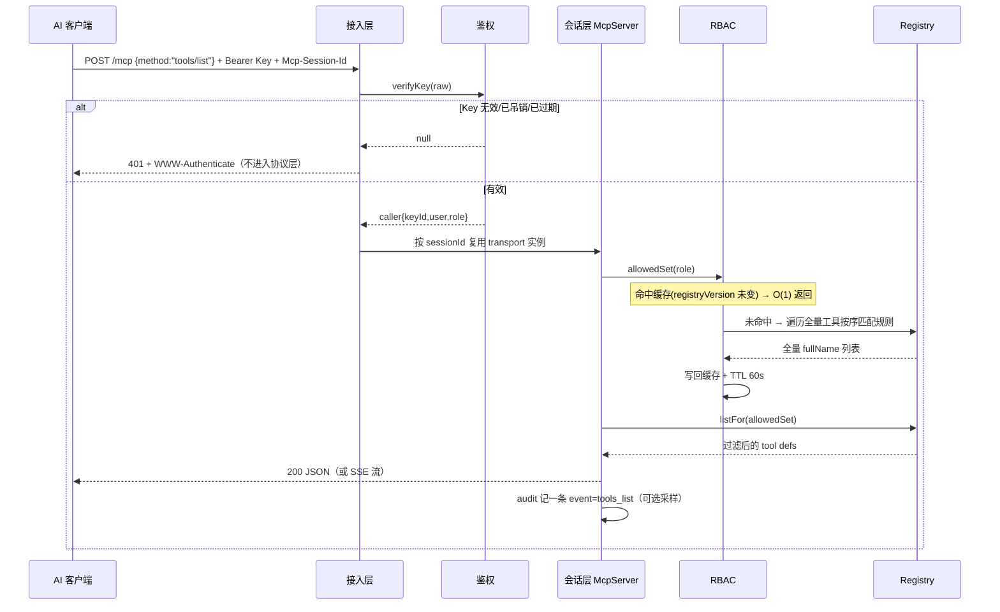
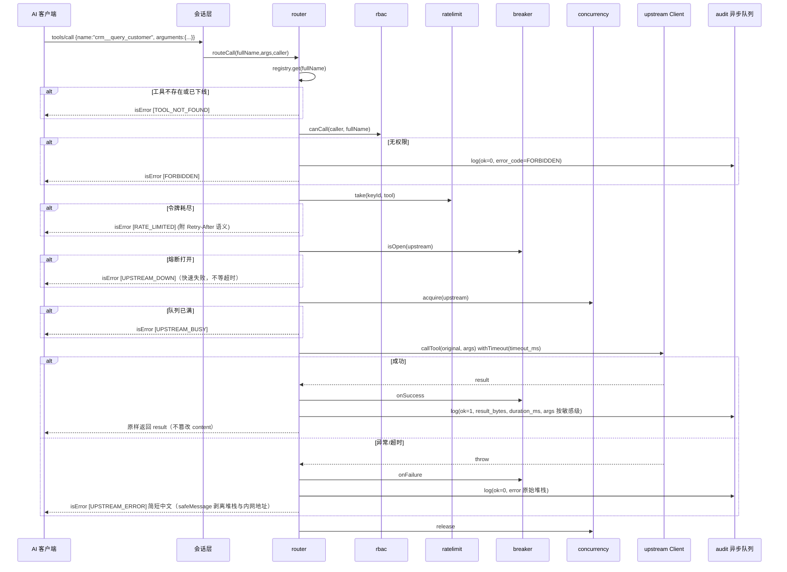

# MCP Gateway 产品技术 PRD

> **版本**：v1.0
> **日期**：2026-09-10
> **状态**：待评审
> **范围**：一期（治理闭环 MVP）；二期路线见第十二章
> **来源**：基于《AI 全栈学习手册》Plus 实战项目6「企业级 MCP 工具网关」的产品化落地版本
> **架构主张**：**轻量化优先** —— 单 Node.js 进程 + 单个 SQLite 文件 + 零前端框架，一台 2C4G 机器即可服务 50～200 人团队

---

## 一、产品定位与边界

### 1.1 一句话定位

MCP Gateway 是部署在 **AI 客户端与众多 MCP Server 之间的治理层**：对上表现为唯一的一个 MCP Server，对下以 MCP Client 身份聚合 N 个上游服务，在中间完成**鉴权、权限裁剪、调用审计、限流熔断与配置收敛**。

### 1.2 立项背景

企业规模化引入 MCP 后（典型拐点：内部 Server 数 > 5，接入团队数 > 3），必然出现四类失控：

| 问题 | 现场表现 | 后果 |
|---|---|---|
| **权限失控** | 实习生的 AI 助手也能调用「删除工单」工具；数据库 Server 对所有使用者暴露全部表 | 数据误删、越权访问、合规事故 |
| **无法审计** | 安全部门问「上周谁通过 AI 查过客户手机号」，无人能答 | 无法通过安全审查，出事无法定责 |
| **配置混乱** | 每人客户端手工配 20 个 Server 地址与密钥，密钥散落在个人配置文件、代码仓库、聊天群 | 密钥泄漏、轮换无从下手 |
| **稳定性黑洞** | 某个 Server 超时拖慢所有 Agent；无人知晓哪个工具调用最多、失败率最高 | 故障不可解释，容量无法规划 |

传统微服务时代的答案是 API 网关；MCP 时代的答案是 **MCP 网关**。本项目即是该方向的完整可交付产品。

### 1.3 产品边界（明确不做什么）

划定边界是防止一期范围膨胀的关键。以下**均不在本期内**：

| 不做 | 原因 | 归属 |
|---|---|---|
| MCP Server 开发框架 / SDK 封装 | 与官方 `@modelcontextprotocol/sdk` 重复，无护城河 | 官方 SDK |
| Agent 编排、推理、Prompt 管理 | 属应用层职责，网关只做治理，不理解业务语义 | 上层 Agent 应用 |
| LLM 模型网关（转发 OpenAI/DeepSeek 等） | 协议不同（非 MCP），需求方不同 | 二期可选独立模块 |
| 多租户 SaaS 化运营 | 一期定位「企业自部署单组织」，租户隔离会重构整个数据模型 | 二期以后 |
| 工具编排 / 结果改写（把 A 工具输出接 B 工具输入） | 会引入不可控的语义改写风险，且与"最小治理层"定位冲突 | 二期评估 |
| 前端管理台框架化（Vue/React） | 违反轻量化主张；纯 HTML + fetch 六个页面足够 | 不做 |

**一句话概括边界**：网关是一台**只做"能不能用、能不能调、调了什么、花多久"四件事的透明代理 + 治理台账**，不碰业务语义。

### 1.4 一期成功判据

一期交付完成的客观标准（可验证，不接受主观评价）：

1. **接入收敛**：目标企业内 ≥ 80% 的 MCP 调用经由网关完成，客户端只需配置 1 个地址。
2. **密钥收敛**：终端用户配置文件中出现的上游真实密钥数量为 **0**（全部由网关保管）。
3. **审计全覆盖**：任意一次工具调用可在后台用一条查询定位到「谁、何时、哪个工具、参数摘要、结果大小、耗时、成败」。
4. **权限生效即时**：权限规则变更后，对应 Key 的 `tools/list` 结果在 **≤ 5 秒**内反映变化。
5. **故障不自愈不扩散**：任一上游宕机时，其工具在 ≤ 30 秒内从列表消失，其余上游调用不受影响；上游恢复后 ≤ 90 秒自动回归。
6. **可运维**：单条 `pm2 start` 或 `docker compose up -d` 完成部署；有 Runbook；数据可备份可恢复。

### 1.5 目标规模（容量设计输入）

轻量化架构必须有明确规模假设，超出即触发扩展路线（第六章）：

| 维度 | 一期设计目标 | 超出信号 |
|---|---|---|
| 上游 Server 数 | ≤ 30（其中 stdio 托管 ≤ 10） | > 30 → 注册表刷新耗时上升 |
| 聚合工具数 | ≤ 800 | > 500 时客户端上下文膨胀，需工具 Profile |
| API Key 数 | ≤ 500 | — |
| 在线并发会话 | ≤ 200 | > 200 → 会话内存与 FD 上限 |
| 稳态调用量 | ≤ 300 QPS，峰值 800 QPS | > 300 QPS 持续 → 需多实例 |
| 审计日志量 | ≤ 5,000 万条（90 天在线） | 超期数据归档而非扩容 |

---

## 二、目标用户与核心场景

### 2.1 角色画像

| 角色 | 身份 | 核心诉求 | 使用频次 | 关键页面 |
|---|---|---|---|---|
| **平台管理员**（Admin） | 企业内 1～3 人，通常是平台工程 / IT | 注册下线上游、签发吊销 Key、配置权限规则，且**不误伤业务** | 每日 | 上游管理、Key 管理、权限矩阵 |
| **安全审计员**（Auditor） | 安全 / 合规部门 | 快速回答"谁在什么时候通过 AI 动过什么数据"，权限变更可追溯 | 每周 + 事件驱动 | 审计查询、变更留痕 |
| **团队负责人**（Owner） | 业务团队 TL | 看清本团队调用量、失败率、异常账号 | 每周 | 总览仪表盘 |
| **AI 应用使用者**（Caller） | 一线员工，使用各类 AI 客户端 / 自研 Agent | 配一次就能用，别让我管 20 个地址和密钥 | 每日高频 | 无需页面（只用客户端） |
| **上游服务负责人**（Upstream Owner） | 各 MCP Server 的开发者 | 上游挂了能第一时间知道是自己还是网关的问题 | 故障时 | 上游详情 + 自身健康指标 |

> **注意角色分离**：Auditor 与 Admin 必须可以是不同人。**管理员自己的每一次配置变更也必须进审计**，否则治理系统自身失去可信度（见 5.5 `change_logs`）。

### 2.2 核心用户故事与验收标准

采用 Given-When-Then 明确可测。

**US-01 权限裁剪（最高优先级）**
> Given 角色 `intern` 未获得任何 `crm__*` 的 allow 规则
> When 实习生用其 API Key 请求 `tools/list`
> Then 返回结果中不出现任何 `crm__` 前缀工具
> And 即使其直接构造 `tools/call` 请求 `crm__query_customer`，也返回 `[FORBIDDEN]` 且**写入一条 `ok=0` 的审计记录**

**US-02 密钥收敛**
> Given 上游 `crm` 需要 `Authorization: Bearer sk-xxx`
> When 管理员在后台注册该上游并填入凭据
> Then 凭据以 AES-256-GCM 密文入库，前端展示为 `Bearer sk-****`
> And 终端用户客户端配置中只出现网关地址与网关 Key，不出现 `sk-xxx`

**US-03 故障隔离**
> Given 上游 `wiki` 连续 5 次调用失败
> When 第 6 次调用到达
> Then 立即返回 `[UPSTREAM_DOWN]`（不等 20 秒超时）
> And 30 秒内 `wiki__*` 工具从所有客户端的 `tools/list` 中消失
> And `crm__*` 工具调用成功率不受影响
> And 熔断事件通过 IM webhook 通知 `wiki` 的 owner 字段所填负责人

**US-04 审计回溯**
> Given 审计员需要知道"过去 7 天谁查询过客户手机号"
> When 在审计查询页筛选 `sensitive=1` + 时间范围 + 关键词
> Then 分页返回结果，含用户名、工具、时间、耗时、参数摘要
> And 单次查询响应 ≤ 2 秒（走索引，非全表扫描）

**US-05 变更可预览**
> Given 管理员在权限矩阵页取消 `support × crm__delete_record` 的勾
> When 点击保存
> Then 先弹出影响预览：「本次将使角色 support 失去 1 个工具，影响 12 个在线 Key」
> And 确认后才落库，并在 `change_logs` 记录操作人、变更前后规则差异

**US-06 存量 stdio Server 托管**
> Given 某团队提供一个只有 stdio 传输的本地 MCP Server（`npx @xxx/mcp-db`）
> When 管理员以 stdio 方式注册并启动
> Then 网关拉起子进程并代理其工具，客户端仍可正常调用
> And 子进程意外退出时自动重启（指数退避，上限 5 分钟），连续失败则标记该上游 `down`

**US-07 Key 泄漏应急**
> Given 某 Key 被误提交进公开代码仓库
> When 管理员在后台按前缀定位并吊销
> Then 该 Key 的后续请求返回 401，**生效延迟 ≤ 10 秒**（受鉴权缓存 TTL 约束）
> And 可一键导出该 Key 近 30 天全部调用供影响面评估

### 2.3 端到端主场景（Day-1 全链路验收）



---

## 三、市场与竞品分析

### 3.1 赛道判断

MCP 生态当前（2026）的工程热点已从「写一个 Server」转移到「**治理一堆 Server**」。企业采购意愿集中在三点：权限、审计、可观测。因此 MCP 网关是 MCP 相关工程岗位面试与商单中**溢价最高的方向**，也是本手册 Plus 内容的核心差异化项目。

### 3.2 方案对比

| 方案 | 形态 | 权限模型 | 审计 | 部署复杂度 | 二次开发成本 | 中文运维 |
|---|---|---|---|---|---|---|
| **本方案 MCP Gateway** | 单进程 Node + SQLite | RBAC 通配符规则 + 默认拒绝 | 内建全量调用台账 + 敏感分级 | **极低**（1 台机 / 1 个文件） | 低（代码量 ~6k 行，全栈可读） | 强 |
| Kong / APISIX + MCP 插件 | 传统 API 网关加插件 | 消费者 + ACL | 依赖网关日志链路 | 高（需 PG/etcd 集群） | 中（Lua/Go 插件） | 弱 |
| Docker MCP Toolkit / Gateway | 官方生态工具 | 以容器隔离为主 | 弱 | 中（强绑定 Docker） | 高（黑盒） | 弱 |
| 开源 mcp-gateway 类项目 | Node/Go 单服务 | 多为简单 allowlist | 有则较粗 | 低 | 中（质量参差） | 弱 |
| LiteLLM Proxy | **LLM** 网关，非 MCP | 强（virtual key + budget） | 强 | 中 | 高（协议不匹配） | 中 |
| 完全自研（无产品设计） | 各异 | 常退化为硬编码 | 常缺失 | 不可控 | — | — |

### 3.3 差异化壁垒

1. **轻量化交付**：无 PG、无 Redis、无消息队列、无 K8s，一条命令起服务，中小团队当天可用。这是 Kong 路线做不到的。
2. **权限即视图**：把 RBAC 结果直接渲染成「角色 × 工具」矩阵并可预览变更影响，而非藏在配置文件里 —— 这是治理类产品的体验分水岭。
3. **审计以"安全部门的问题"为设计输入**：表结构和索引围绕真实取证问句设计，不是随手 `log.info`。
4. **协议正确性**：严格实现 Streamable HTTP 的 session、`MCP-Protocol-Version`、SSE 流、`tools/list_changed` 通知，多数开源实现这块是残缺的。
5. **可读可改**：全栈约 6000 行、零框架，中型团队能自行二开 —— 与手册"能落地"的教学主张一致。

---

## 四、功能地图

```
MCP Gateway 功能全景
│
├── P0 一期必交付（治理闭环）
│   ├── 网关核心
│   │   ├── 上游连接管理：HTTP(Streamable) 接入 + 连接池 + 健康检查 + 自动重连
│   │   ├── stdio 上游托管：子进程拉起、请求串行化、崩溃重启
│   │   ├── 工具注册表：命名空间聚合（upstream__tool）+ 定时/list_changed 刷新
│   │   ├── 调用路由与转发：鉴权→权限→限流→熔断→超时→审计
│   │   └── 错误归一化：[错误码] 中文简述，原始堆栈只进审计
│   ├── 治理
│   │   ├── API Key：签发（明文仅一次）/ 吊销 / 过期 / 前缀识别 / 只存哈希
│   │   ├── RBAC：通配符规则 + 顺序匹配 + 默认拒绝；同一集合驱动 list 与 call
│   │   ├── 审计日志：异步攒批落库、敏感分级、组合筛选与分页
│   │   ├── 限流：令牌桶（key×tool 维度）+ 上游并发上限
│   │   └── 熔断：closed / open / half-open 三态 + IM 告警
│   ├── 管理后台（纯 HTML + fetch）
│   │   ├── 总览仪表盘 / 上游管理 / 工具列表（含描述覆写）
│   │   ├── 权限矩阵（规则计算视图 + 变更预览 + 影响面）
│   │   ├── Key 管理 / 审计查询 / 变更留痕
│   ├── 自身可观测：/healthz、/metrics、结构化日志、IM webhook
│   └── 部署与运维：pm2 与 Docker 双路径、Nginx SSE 配置、备份恢复、Runbook
│
├── P1 一期尽量交付（体验与安全补强）
│   ├── 工具 Profile：按角色/客户端下发工具子集，解决 500+ 工具上下文膨胀
│   ├── 幂等查询结果缓存（按 args 哈希，TTL 可配）
│   ├── 多管理员账号（替代单一 Admin Token）+ 登录失败锁定
│   ├── 参数级细粒度权限（按 args 中的字段值裁剪，如只能查本部门 customer_id）
│   └── 审计月度归档（CSV.gz 导出 + 在线窗口滚动 90 天）
│
└── P2 二期路线
    ├── OIDC / 企业 SSO 对接，权限跟随组织架构同步
    ├── 成本核算与团队账单（调用量 → 货币化）
    ├── MCP 市场：业务团队自助注册上游 + 管理员审批流
    ├── 多实例水平扩展（会话外置 + 限流后端切换 + PostgreSQL）
    └── 工具质量评测：调用成功率 / 参数错误率 → 反哺描述优化
```

---

## 五、技术方案

### 5.1 技术选型

| 组件 | 选型 | 版本约束 | 理由 | 代价 / 注意 |
|---|---|---|---|---|
| 运行时 | Node.js | **≥ 20.18.1**（推荐 22 LTS） | 与官方 MCP SDK 同生态，`fetch`/`crypto` 内建，无 polyfill | SDK 依赖 ESM；`fs.cp`、`structuredClone` 等需新版本 |
| 模块系统 | **ESM**（`"type": "module"`） | — | `@modelcontextprotocol/sdk` **仅提供 ESM 导出**，CommonJS `require` 会直接失败 | ⚠️ 与本仓库 `backend/` 的 CJS 风格不一致：作为**独立项目**建仓库，不要塞进现有 backend 再混用；若必须混用，仅可在 CJS 侧用 `await import()` 动态引入 |
| MCP 协议层 | `@modelcontextprotocol/sdk` | 锁定 `^1.x` 精确小版本 | 同时提供 Server 与 Client，正是网关"两面人"角色所需 | ⚠️ 本仓库 `backend/node_modules` **当前未安装**，需新增依赖；SDK 迭代快，升级必须跑契约测试（见第十章） |
| 对上传输 | Streamable HTTP | spec `2025-06-18` | 网关是多人共享服务，必须走网络传输而非 stdio | 需实现 session 管理、SSE 流、`MCP-Protocol-Version` 校验 |
| 对下传输 | Streamable HTTP 为主 + stdio 子进程托管 | — | 存量 stdio Server 可由网关拉起代理，扩大适用面 | stdio 每上游一个子进程，内存 60～120 MB/个，需限额 |
| HTTP 框架 | Express | `^4.18` | 与现有后端一致，团队零学习成本；SDK 有现成 express 集成示例 | **勿升 Express 5**（路由与错误处理语义变更）；`express.json({ limit: '1mb' })` 必须显式设置 |
| 参数校验 | `zod` | `^3.x` | SDK 内置依赖，复用它做 Admin API 入参校验，不引第 4 个校验库 | — |
| 存储 | SQLite（`better-sqlite3`） | `^9.4`（沿用仓库版本） | 配置 + 审计 + 注册表快照，单机起步完全够用；**同步 API 免回调地狱，事务简单** | ⚠️ 同步执行会**阻塞事件循环**：审计写库必须走异步攒批（5.5.4），单次事务须控制在毫秒级 |
| 并发控制 | `node:worker_threads` | — | 一期不需要；注册表刷新走 `setImmediate` 让路 | 若 tools/list 计算成为热点再评估，不提前优化 |
| 管理后台 | 原生 HTML + `fetch` + 模板字符串 | — | 零构建、零框架，六页面 1000 行内可完成，符合轻量化主张 | 不引前端框架；不引 ECharts（图表用纯 CSS 条形或内联 SVG） |
| 进程守护 | pm2（路径 A）/ docker compose（路径 B） | — | 复用现有部署流水线 | pm2 **cluster 模式禁用**（会话与限流状态在内存） |
| 反向代理 | Nginx | 现有 | TLS 终结 + `/admin` IP 白名单 | SSE 必须 `proxy_buffering off` + 放宽 `read_timeout`（第八章） |

**明确不引入的组件及理由**（防止评审时被过度设计带偏）：

| 不引入 | 理由 | 未来何时需要 |
|---|---|---|
| Redis | 限流令牌桶与熔断状态在单进程内存即可；会话也在内存 | 多实例水平扩展时（P2） |
| 消息队列（Kafka/NATS） | 审计落库延迟 1 秒完全可接受，内存队列 + 攒批事务足够 | 审计需实时同步到外部数仓时 |
| PostgreSQL | 一期数据量（< 5000 万行审计）单机 SQLite 无压力 | 多实例写、或审计量 > 1 亿行 |
| Prometheus + Grafana | 用 `/metrics` JSON + 现有监控拉取，不自建 TSDB | 需要长期趋势与 SLO 告警时 |
| ORM（Sequelize/Prisma） | `better-sqlite3` 直接写 SQL 更可控，且团队已熟悉 | 不计划引入 |
| OIDC 库（openid-client） | 一期 API Key 闭环；SSO 是 P2 | 二期对接企业身份时 |

### 5.2 整体架构

```
┌──────────────────────────────────────────────────────────────────────────┐
│                        调用方：Cursor / Claude Desktop / 自研 Agent        │
└───────────────────────────────┬──────────────────────────────────────────┘
                                │  MCP over Streamable HTTP
                                │  Authorization: Bearer mgw_live_xxx
┌───────────────────────────────▼──────────────────────────────────────────┐
│                            MCP Gateway (单进程)                            │
│                                                                          │
│  ┌── 接入层 (transport/) ─────────────────────────────────────────────┐  │
│  │  POST /mcp  ·  GET /mcp(SSE)  ·  DELETE /mcp                      │  │
│  │  Origin/Host 校验  ·  MCP-Protocol-Version 协商  ·  Session 管理   │  │
│  └───────────────────────────────┬───────────────────────────────────┘  │
│                                  │ authenticate → caller{id,user,role}   │
│  ┌── 会话层 (server/) ────────────▼───────────────────────────────────┐  │
│  │  每 session 一个 McpServer 实例（handler 闭包携带 caller）          │  │
│  │  tools/list → allowedSet 过滤   tools/call → 路由入口              │  │
│  └───────────────────────────────┬───────────────────────────────────┘  │
│                                  │                                        │
│  ┌── 治理层 (governance/) ───────▼──────────────────────────────────┐  │
│  │  rbac: buildAllowedSet(role, registry)  ← 按 registryVersion 缓存   │  │
│  │  ratelimit: 令牌桶(key×tool) + 上游并发信号量                        │  │
│  │  breaker: 三态熔断 (closed/open/half-open)                          │  │
│  │  audit: 内存队列 → 攒批事务落库；args 脱敏；sensitive 分级           │  │
│  └───────────────────────────────┬───────────────────────────────────┘  │
│                                  │                                        │
│  ┌── 核心层 (gateway/) ──────────▼───────────────────────────────────┐  │
│  │  registry: fullName→{upstream,original,def}  + overrides 套用       │  │
│  │  upstream: Client 池 + 健康检查 + 自动重连 + stdio 子进程托管        │  │
│  │  router:   权限→限流→熔断→超时转发→错误归一化                       │  │
│  └───────────────────────────────┬───────────────────────────────────┘  │
│                                  │                                        │
│  ┌── 数据层 (db.js) ──────────────▼───────────────────────────────────┐  │
│  │  better-sqlite3 (WAL)  ·  repo 接口抽象，为 PostgreSQL 预留         │  │
│  └───────────────────────────────────────────────────────────────────┘  │
│                                                                          │
│  ┌── 管理面 (admin/) ─────────────────────────────────────────────────┐  │
│  │  /admin/api/*  REST（独立 Admin Token 鉴权，与 MCP 通道完全隔离）    │  │
│  │  /admin/*      纯静态页面（6 个）                                   │  │
│  │  /healthz      /metrics   （无鉴权，供监控拉取；仅绑 127.0.0.1）    │  │
│  └───────────────────────────────────────────────────────────────────┘  │
└───────────────────────────────┬──────────────────────────────────────────┘
                                │  MCP（Streamable HTTP / stdio 子进程）
              ┌─────────────────┼─────────────────┬─────────────────┐
              ▼                 ▼                 ▼                 ▼
        wiki Server       crm Server        db-query Server    工单 Server
        (HTTP, normal)    (HTTP, high)      (stdio 托管)       (HTTP)
```

**分层职责的唯一判据**：一次改动是否影响"能不能调用"？是 → 治理层；影响"调用发到哪" → 核心层；影响"怎么和客户端说话" → 传输/会话层。三者不互相越界，是后续能替换存储和传输的前提。

### 5.3 目录结构

```
mcp-gateway/
├── package.json                 # "type": "module"，依赖锁定精确版本
├── .env.example                 # 全部环境变量声明（不含真实值）
├── config/
│   └── gateway.json             # 冷启动兜底配置 + 首次启动种子数据
├── src/
│   ├── index.js                 # 入口：加载配置→建库→连上游→起 HTTP→优雅退出
│   ├── config.js                # 三级配置加载（默认值 < 文件 < 环境变量）
│   ├── db.js                    # SQLite 初始化、WAL、schema_migrations、事务工具
│   ├── repo/                    # ★ 数据访问抽象层（未来换 PG 的唯一改动点）
│   │   ├── index.js             # 统一导出，屏蔽方言差异
│   │   ├── upstreams.js
│   │   ├── keys.js
│   │   ├── rules.js
│   │   ├── audit.js
│   │   └── changes.js
│   ├── transport/
│   │   ├── http.js              # Express 路由装配：/mcp /healthz /metrics /admin
│   │   ├── session.js           # ★ session 生命周期、TTL 回收、优雅退出排空
│   │   └── security.js          # Origin/Host 校验、请求体上限、鉴权前置
│   ├── gateway/
│   │   ├── upstream.js          # UpstreamManager：Client 池、健康检查、重连退避
│   │   ├── stdioHost.js         # stdio 子进程托管 + 崩溃重启 + 并发串行化
│   │   ├── registry.js          # ToolRegistry：聚合、命名空间、版本戳、快照落库
│   │   └── router.js            # routeCall：治理链 + 超时 + 归一化
│   ├── auth/
│   │   ├── apikey.js            # 签发 / 校验 / 吊销 / 鉴权结果缓存
│   │   ├── rbac.js              # 规则匹配、正则缓存、allowedSet 计算与缓存
│   │   └── crypto.js            # SHA-256、AES-256-GCM（上游凭据加解密）
│   ├── governance/
│   │   ├── audit.js             # 内存队列 + 攒批 flush + 退出强制落盘
│   │   ├── ratelimit.js         # 令牌桶 + 后端接口（memory|sql|redis 预留）
│   │   ├── breaker.js           # 三态熔断器
│   │   ├── concurrency.js       # 上游并发信号量 + 排队上限
│   │   └── redact.js            # PII 正则脱敏（手机/身份证/银行卡/邮箱）
│   ├── admin/
│   │   ├── api.js               # REST 路由（zod 校验 + Admin Token 鉴权）
│   │   ├── stats.js             # 报表聚合 SQL
│   │   └── public/
│   │       ├── index.html       # 单页外壳：左侧导航 + 内容区
│   │       ├── admin.js         # fetch 封装（带 Admin Token）+ 各页渲染
│   │       └── admin.css
│   └── notify/
│       └── im.js                # 钉钉/企微/飞书 webhook（统一 HTTP POST）
├── test/
│   ├── mock-upstream.js         # ★ 契约测试用假上游（含慢响应/抛错工具）
│   ├── rbac.test.js
│   ├── ratelimit.test.js
│   ├── breaker.test.js
│   ├── audit.test.js
│   └── contract.test.js         # 可见即可调一致性 + 端到端
└── deploy/
    ├── nginx.conf.example
    ├── Dockerfile
    ├── docker-compose.yml
    ├── ecosystem.config.cjs      # pm2 配置（fork 模式，禁 cluster）
    └── RUNBOOK.md
```

**规模预估**：`src/` 约 4200 行、`admin/public/` 约 1000 行、`test/` 约 800 行 —— 1 名全栈 6 周，或 2 人 4 周。

### 5.4 关键时序

#### 5.4.1 `tools/list`（权限裁剪发生在这里）



**三个必须做对的细节**：

1. **过滤点在 list 而非只在 call**：看不见的工具才是安全的工具，同时减少模型的工具选择噪声。**但 `tools/call` 侧仍必须二次校验** —— 客户端可能缓存了旧列表或直接构造请求，两处共用同一份 `allowedSet`。
2. **`allowedSet` 缓存以 `(role, registryVersion)` 为键**：注册表刷新时 `registryVersion++`，缓存整体失效；否则会出现"上游新工具已出现但该角色看不到"或反向的权限漂移。
3. **规则正则预编译缓存**：600 工具 × 20 规则 = 12000 次匹配，若每次 `new RegExp` 会把 `tools/list` 拖到毫秒级抖动。用 `Map<pattern, RegExp>` 缓存。

#### 5.4.2 `tools/call`（治理链，整个系统的十字路口）



**设计意图**：

- **错误归一化**：上游报错千奇百怪（堆栈、HTML 错误页、gRPC 码），一律收敛为 `[错误码] 简短中文说明`。原始错误进审计供人排查，**给模型的错误要短且可行动**（这是上下文工程在工具层的直接落点）。
- **`isError:true` 而非 JSON-RPC error**：符合 MCP 规范对"工具业务失败"的语义，让模型有机会调整策略；而协议级错误（未知方法、鉴权失败）仍走 JSON-RPC error / HTTP 状态码。
- **顺序不可调换**：权限在限流前（无权限的请求不该消耗令牌），限流在熔断前（被限流的请求不该污染熔断统计），熔断在获取并发槽前（熔断态不该排队）。


### 5.5 数据模型

单库 `data/gateway.db`，WAL 模式。**所有时间戳统一用 `INTEGER` epoch 毫秒**（沿用本仓库 `backend/db.js` 与 `agent/db.js` 的既有约定，便于排序、索引范围扫描与前端格式化；仅在需要人肉读库时用 `datetime(ts/1000,'unixepoch')` 转换）。

#### 5.5.1 迁移与元数据

```sql
-- 轻量迁移：与 backend/agent/db.js 的 schema_migrations 模式保持一致
CREATE TABLE IF NOT EXISTS schema_migrations (
  version    INTEGER PRIMARY KEY,
  name       TEXT    NOT NULL,
  applied_at INTEGER NOT NULL
);

-- 全局设置（限流默认值、超时、审计开关等），避免为几个常量建新表
CREATE TABLE IF NOT EXISTS settings (
  key        TEXT PRIMARY KEY,
  value      TEXT NOT NULL,
  updated_by TEXT NOT NULL DEFAULT '',
  updated_at INTEGER NOT NULL
);
```

内置 `settings` 初值：

| key | 默认值 | 说明 |
|---|---|---|
| `ratelimit.default_qpm` | `30` | 每 Key 每工具每分钟默认令牌 |
| `ratelimit.burst` | `30` | 桶容量（默认等同速率，允许 1 分钟突发） |
| `upstream.timeout_ms` | `20000` | 全局默认上游超时 |
| `upstream.concurrency` | `20` | 单上游默认并发上限 |
| `audit.enabled` | `1` | 总开关（关闭后仅记 `event!=tool_call` 的治理事件） |
| `audit.args_full_threshold` | `4096` | 参数超此字节数则截断并标记 |
| `registry.refresh_interval_s` | `300` | 注册表兜底刷新周期 |
| `session.idle_timeout_s` | `1800` | 会话闲置回收 |

#### 5.5.2 上游与工具

```sql
CREATE TABLE IF NOT EXISTS upstreams (
  id             INTEGER PRIMARY KEY AUTOINCREMENT,
  name           TEXT    NOT NULL UNIQUE,        -- 命名空间前缀：wiki / crm（^[a-z][a-z0-9_-]{1,31}$）
  display_name   TEXT    NOT NULL DEFAULT '',
  transport      TEXT    NOT NULL DEFAULT 'http'
                 CHECK (transport IN ('http','stdio')),
  -- http 传输
  url            TEXT,                           -- 例：http://10.0.1.6:3002/mcp
  headers_enc    TEXT,                           -- 认证头等，AES-GCM 密文（base64）
  -- stdio 传输
  command        TEXT,                           -- 例：npx
  args_json      TEXT,                           -- JSON 数组
  cwd            TEXT,
  env_enc        TEXT,                           -- 子进程环境变量密文
  -- 治理属性
  sensitivity    TEXT    NOT NULL DEFAULT 'normal'
                 CHECK (sensitivity IN ('normal','high')),
  enabled        INTEGER NOT NULL DEFAULT 1,
  owner          TEXT    NOT NULL DEFAULT '',    -- 负责人，熔断告警路由对象
  timeout_ms     INTEGER NOT NULL DEFAULT 20000,
  concurrency    INTEGER NOT NULL DEFAULT 20,
  remark         TEXT    NOT NULL DEFAULT '',
  -- 运行态（由网关回写，非配置）
  last_status    TEXT    NOT NULL DEFAULT 'unknown'
                 CHECK (last_status IN ('up','down','unknown')),
  last_error     TEXT    NOT NULL DEFAULT '',
  last_checked_at INTEGER,
  created_at     INTEGER NOT NULL,
  updated_at     INTEGER NOT NULL
);

-- 工具快照：注册表的持久化视图，供权限矩阵在"工具尚未被任何调用触及"时也能渲染
CREATE TABLE IF NOT EXISTS tools_snapshot (
  full_name     TEXT PRIMARY KEY,                -- wiki__search
  upstream      TEXT NOT NULL,
  original_name TEXT NOT NULL,
  title         TEXT NOT NULL DEFAULT '',
  description   TEXT NOT NULL DEFAULT '',        -- 上游原始描述（不含覆写）
  input_schema  TEXT NOT NULL DEFAULT '{}',      -- 原样 JSON 文本，网关绝不篡改
  first_seen_at INTEGER NOT NULL,
  last_seen_at  INTEGER NOT NULL
);
CREATE INDEX IF NOT EXISTS idx_tools_snap_upstream ON tools_snapshot(upstream);

-- 管理员覆写（描述、下线、限流、缓存）
CREATE TABLE IF NOT EXISTS tool_overrides (
  full_name   TEXT PRIMARY KEY,
  description TEXT,                             -- NULL 表示不覆写
  enabled     INTEGER NOT NULL DEFAULT 1,       -- 0 = 单个工具下线（下架危险工具不必停整个上游）
  rate_qpm    INTEGER,                          -- 按工具覆写限流速率
  cache_ttl_s INTEGER NOT NULL DEFAULT 0,       -- 0 = 不缓存（P1 生效）
  note        TEXT NOT NULL DEFAULT '',
  updated_by  TEXT NOT NULL DEFAULT '',
  updated_at  INTEGER NOT NULL
);
```

> **为什么不把 `description` 覆写直接写进 `tools_snapshot`**：快照每次刷新都会被上游数据覆盖，覆写必须与来源分离，否则刷新即丢失管理员配置。这是聚合类系统最常见的数据设计错误。

#### 5.5.3 身份与权限

```sql
CREATE TABLE IF NOT EXISTS roles (
  name        TEXT PRIMARY KEY,                 -- intern / support / admin
  description TEXT NOT NULL DEFAULT '',
  is_builtin  INTEGER NOT NULL DEFAULT 0,       -- 内置角色不可删（admin 尤其）
  created_at  INTEGER NOT NULL
);

-- 规则：按 sort 升序匹配，首条命中即决定；无命中 = 默认拒绝
CREATE TABLE IF NOT EXISTS role_rules (
  id     INTEGER PRIMARY KEY AUTOINCREMENT,
  role   TEXT    NOT NULL REFERENCES roles(name) ON DELETE CASCADE,
  effect TEXT    NOT NULL CHECK (effect IN ('allow','deny')),
  pattern TEXT   NOT NULL,                      -- 'wiki__*' | '*__delete_*' | '*'
  sort   INTEGER NOT NULL DEFAULT 0,
  memo   TEXT    NOT NULL DEFAULT ''            -- 为什么加这条规则（半年后救命的字段）
);
CREATE INDEX IF NOT EXISTS idx_rules_role ON role_rules(role, sort);

CREATE TABLE IF NOT EXISTS api_keys (
  id         INTEGER PRIMARY KEY AUTOINCREMENT,
  key_hash   TEXT    NOT NULL UNIQUE,           -- SHA-256(rawKey) hex
  key_prefix TEXT    NOT NULL,                  -- 'mgw_live_ab12c3' 前缀，供后台识别
  name       TEXT    NOT NULL,                  -- 用途命名：'张三-工作电脑'
  user_name  TEXT    NOT NULL,                  -- 归属人
  team       TEXT    NOT NULL DEFAULT '',       -- 报表按团队聚合
  role       TEXT    NOT NULL REFERENCES roles(name),
  profile    TEXT    NOT NULL DEFAULT '',       -- 工具 Profile 名（P1），空=不按 profile 裁剪
  expires_at INTEGER,                           -- NULL = 永不过期
  revoked    INTEGER NOT NULL DEFAULT 0,
  revoked_at INTEGER,
  revoke_reason TEXT NOT NULL DEFAULT '',       -- 'leak' | 'offboard' | 'rotate'
  last_used_at INTEGER,
  created_by TEXT    NOT NULL DEFAULT '',
  created_at INTEGER NOT NULL
);
CREATE INDEX IF NOT EXISTS idx_keys_prefix ON api_keys(key_prefix);
CREATE INDEX IF NOT EXISTS idx_keys_user   ON api_keys(user_name);
```

内置角色与种子规则（首次启动写入，与手册项目6保持一致）：

| 角色 | 规则（按 sort 升序） | 净效果 |
|---|---|---|
| `intern` | 1. `deny crm__*` → 2. `allow wiki__*` | 只能查 Wiki |
| `support` | 1. `deny *__delete_*` → 2. `allow crm__*` → 3. `allow wiki__*` | 可用 CRM 但禁止一切删除类工具 |
| `admin` | 1. `allow *` | 全量 |

**`last_used_at` 的写放大陷阱**：每次调用都 UPDATE 一行会让热 key 频繁写盘，与审计攒批叠加会显著抬高 WAL 压力。做法：**内存记录 + 每 Key 每分钟最多落库一次**（`flushKeyUsage()` 随审计攒批一起提交）。

#### 5.5.4 审计与变更留痕

```sql
CREATE TABLE IF NOT EXISTS audit_logs (
  id           INTEGER PRIMARY KEY AUTOINCREMENT,
  ts           INTEGER NOT NULL,                -- epoch ms
  request_id   TEXT    NOT NULL,                -- 单次调用唯一 id，串联日志与工单
  event        TEXT    NOT NULL
               CHECK (event IN ('tool_call','tools_list','initialize','auth_fail','rate_limit','circuit_open','circuit_close','upstream_down','upstream_up','admin_op')),
  channel      TEXT    NOT NULL DEFAULT 'mcp'   CHECK (channel IN ('mcp','admin','health')),
  key_id       INTEGER,
  user_name    TEXT,
  team         TEXT,
  role         TEXT,
  session_id   TEXT,
  tool         TEXT,                            -- wiki__search
  upstream     TEXT,
  args_digest  TEXT,                            -- 普通工具：SHA-256 前 16 位 + 脱敏摘要
  args_full    TEXT,                            -- 敏感工具：脱敏后全量 JSON
  result_bytes INTEGER,
  result_ok    INTEGER NOT NULL DEFAULT 1,      -- 1 成功 / 0 失败
  error_code   TEXT,
  error_msg    TEXT,                            -- 原始错误（含堆栈），仅内部可见
  duration_ms  INTEGER,
  queue_ms     INTEGER,                         -- 在上游并发队列中的等待时间
  sensitive    INTEGER NOT NULL DEFAULT 0,
  redacted     INTEGER NOT NULL DEFAULT 0,      -- 是否做过 PII 脱敏
  caller_ip    TEXT,
  client_info  TEXT                             -- 客户端 name/version（initialize 捕获）
);

-- 索引以"安全部门的问题"为设计输入，每条问句对应一条索引
CREATE INDEX IF NOT EXISTS idx_audit_ts        ON audit_logs(ts);
CREATE INDEX IF NOT EXISTS idx_audit_user_ts   ON audit_logs(user_name, ts);
CREATE INDEX IF NOT EXISTS idx_audit_tool_ts   ON audit_logs(tool, ts);
CREATE INDEX IF NOT EXISTS idx_audit_up_ts     ON audit_logs(upstream, ts);
CREATE INDEX IF NOT EXISTS idx_audit_sensitive ON audit_logs(sensitive, ts);
CREATE INDEX IF NOT EXISTS idx_audit_key_ts    ON audit_logs(key_id, ts);
CREATE INDEX IF NOT EXISTS idx_audit_req       ON audit_logs(request_id);
```

配置变更单独成表 —— 审计员关心的是"谁改了什么规则"，与调用台账是两种查询模式、两种保留策略：

```sql
CREATE TABLE IF NOT EXISTS change_logs (
  id         INTEGER PRIMARY KEY AUTOINCREMENT,
  ts         INTEGER NOT NULL,
  actor      TEXT    NOT NULL,                  -- 管理员标识 / 'system'
  actor_ip   TEXT    NOT NULL DEFAULT '',
  target_type TEXT   NOT NULL,                  -- 'upstream'|'role_rules'|'api_key'|'tool_override'|'settings'
  target_id  TEXT    NOT NULL,
  action     TEXT    NOT NULL,                  -- 'create'|'update'|'delete'|'revoke'|'enable'|'disable'
  before_json TEXT,                             -- 变更前完整对象（脱敏后）
  after_json  TEXT,
  diff_summary TEXT NOT NULL DEFAULT ''         -- 人类可读：'support 角色新增 deny crm__delete_record'
);
CREATE INDEX IF NOT EXISTS idx_change_ts     ON change_logs(ts);
CREATE INDEX IF NOT EXISTS idx_change_target ON change_logs(target_type, target_id);
```

**三条落地纪律**：

1. **异步攒批写**（⚠️ 关键性能点）：`better-sqlite3` 是同步 API，若在请求主链路直接 `INSERT`，每次磁盘 `fsync` 会把事件循环卡住，表现为**所有客户端一起变慢**。做法：请求内只 `queue.push(entry)`（纯内存数组），由 `setInterval(1000)` 或 `queue.length >= 100` 触发的 `db.transaction(() => {...})` 批量提交；`SIGTERM` / `SIGINT` 钩子中**先 flush 再关库**，崩溃时最多丢 1 秒未确认日志（可接受，且队列有落盘兜底：flush 失败时把批次 append 到 `data/audit-fallback.jsonl`，启动时回放）。
2. **敏感分级**：上游 `sensitivity='high'` ⇒ 该上游全部调用记 `args_full` 且 `sensitive=1`，后台一键筛出。其余仅记摘要，避免审计库自身成为最大的数据泄漏面。
3. **只增不改**：网关进程对该表**无 UPDATE / DELETE 权限级路径**（代码层面不提供）。在线保留 90 天，超期由归档任务导出 `CSV.gz` 后分批 `DELETE`（每批 5000 行、批间 `sleep 50ms`，避免长事务锁库），归档动作本身写入 `change_logs`。

#### 5.5.5 容量估算

| 项 | 估算 | 依据 |
|---|---|---|
| 单条审计平均大小 | 普通 ~350 B；敏感 ~2 KB | 混合按 9:1 计 ≈ 515 B/条 |
| 200 QPS × 8 h/工作日 | ≈ 576 万条/日 → ~3 GB/日 | ⚠️ 高负载场景 |
| 实际典型负载（50 人团队） | 20 QPS 峰值 → 约 50 万条/日 → ~260 MB/日 | 90 天在线 ≈ **23 GB** |
| 索引额外开销 | +45% | 7 条索引 |
| **结论** | 2C4G + 100 GB 磁盘足够支撑 90 天在线窗口 | 超出则缩短在线窗口或按周分区表 |

> **诚实结论**：SQLite 的瓶颈不是行数而是**磁盘 fsync 与索引写放大**。若目标企业稳态 > 150 QPS，或要求在线审计 > 180 天，**直接进入第六章的 PostgreSQL 路线**，不要试图用调优解决架构容量问题。

### 5.6 接口清单

#### 5.6.1 MCP 通道（对客户端）

| 方法与路径 | 用途 | 鉴权 | 说明 |
|---|---|---|---|
| `POST /mcp` | JSON-RPC 主入口（`initialize`/`tools/list`/`tools/call`/`ping`） | `Authorization: Bearer <mgw_live_...>` | 必须同时带 `Accept: application/json, text/event-stream`；`initialize` 响应通过 `Mcp-Session-Id` 响应头下发会话 |
| `GET /mcp` | 服务端 → 客户端 SSE 通知流（`notifications/tools/list_changed`） | 同上 + `Mcp-Session-Id` | 长连接，Nginx 必须关缓冲 |
| `DELETE /mcp` | 客户端主动终止会话 | 同上 + `Mcp-Session-Id` | 释放内存中 transport |

协议正确性要求（评审时逐条核对）：

- 校验 `Origin` / `Host` 头白名单，防 DNS rebinding（SDK 提供 `hostHeaderValidation` / 自行实现同等校验）。
- 回显并校验 `MCP-Protocol-Version`；客户端未带时按规范默认 `2025-03-26` 协商。
- 鉴权失败返回 **HTTP 401**（而非 200 包 JSON-RPC error），并带 `WWW-Authenticate: Bearer resource_metadata="https://gw.../.well-known/oauth-protected-resource"` —— 这是新版客户端自动发现企业 SSO 的钩子，一期先返回固定头为二期 OIDC 预留位置。
- 未知 `Mcp-Session-Id` 返回 404，客户端按规范重新 `initialize`。

#### 5.6.2 Admin REST API

全部挂载于 `/admin/api/*`，`Authorization: Bearer <ADMIN_TOKEN>`，**与 MCP 通道的 Key 体系完全隔离**（不同前缀、不同存储、不同校验函数；网关代码路径上互不可达）。

```http
# ── 上游管理 ────────────────────────────────────────────
GET    /admin/api/upstreams                     # 列表（含实时 status / lastError / 工具数）
POST   /admin/api/upstreams                     # 注册（内部先试连接，失败即返回原因，不落库）
PUT    /admin/api/upstreams/:name               # 更新（url / 凭据 / sensitivity / owner / timeout）
DELETE /admin/api/upstreams/:name               # 下线（断开连接 + 移除工具 + enabled=0，保留审计外键）
POST   /admin/api/upstreams/:name/probe         # 手动健康检查，返回耗时与工具数
POST   /admin/api/upstreams/:name/refresh       # 立即强制刷新该上游工具列表

# ── 工具管理 ────────────────────────────────────────────
GET    /admin/api/tools?upstream=&q=&overridden= # 聚合后全量工具（含覆写状态、被引用角色数）
GET    /admin/api/tools/:fullName               # 详情（inputSchema 原文）
PUT    /admin/api/tools/:fullName/description   # 覆写描述（影响模型调用准确率，属高权重操作）
PUT    /admin/api/tools/:fullName/enabled       # 单个工具上线 / 下线
PUT    /admin/api/tools/:fullName/ratelimit     # 按工具覆写 QPM

# ── Key 与角色 ──────────────────────────────────────────
GET    /admin/api/roles                         # 角色 + 规则
PUT    /admin/api/roles/:role/rules             # 全量替换规则（带 sort）；body 支持 dryRun
POST   /admin/api/roles/:role/preview           # ★ 变更预览：新规则下的可见工具集与受影响 Key 数
GET    /admin/api/permissions/matrix            # 角色 × 工具矩阵（规则实时计算，非存储）
POST   /admin/api/keys                          # 签发（明文只在此响应出现一次）
GET    /admin/api/keys?user=&role=&revoked=      # 列表（只展示 prefix，不展示哈希）
POST   /admin/api/keys/:id/revoke               # 吊销（body: reason）
POST   /admin/api/keys/:id/rotate               # 轮换：签发新 Key 并可设旧 Key 宽限期

# ── 审计与报表 ──────────────────────────────────────────
GET    /admin/api/audit?user=&tool=&upstream=&sensitive=1&ok=0&from=&to=&page=&size=
GET    /admin/api/audit/export?...              # CSV 流式导出（上限 10 万行，超出报错提示缩小范围）
GET    /admin/api/audit/:id                     # 单条详情（含 args_full 与原始 error_msg）
GET    /admin/api/changes?target_type=&actor=&from=&to=&page=
GET    /admin/api/stats/overview?days=7         # 报表聚合（Top 工具 / 失败率 / 上游 P95 / 敏感数 / 用户排行）
GET    /admin/api/stats/timeseries?days=7&bucket=hour   # 趋势折线（调用量与失败率）

# ── 系统 ────────────────────────────────────────────────
GET    /admin/api/system/registry               # 注册表版本、上游状态、会话数、队列深度
POST   /admin/api/system/registry/refresh       # 手动全量刷新
GET    /admin/api/settings                      # 当前生效配置（限流默认值、超时、审计开关）
PUT    /admin/api/settings                      # 更新配置（key 白名单校验，全量进变更留痕）
```

**三个易错点**：

1. **签发响应的明文一次性**：数据库中只有哈希，任何"再看一下"的路径都不存在。前端弹窗强提示"关闭后无法再次查看"，并把明文**只渲染一次**（不留 `data-` 属性、不写 `localStorage`）。
2. **上游注册先试连接再入库**：连不上直接返回失败原因（DNS / 401 / 协议不匹配），否则运维要跑去日志里刨为什么工具没出现 —— 这是治理产品最高频的差评来源。
3. **所有写操作强制 `dryRun` 可选 + 落 `change_logs`**：权限与凭据的变更必须可预览、可追溯。

#### 5.6.3 错误码表（对模型的返回契约）

| 错误码 | 触发条件 | HTTP（通道层） | 给模型的文本 | 客户端建议动作 |
|---|---|---|---|---|
| `UNAUTHORIZED` | Key 缺失/无效/吊销/过期 | 401 | —（不进入工具语义层） | 检查配置，联系管理员 |
| `FORBIDDEN` | RBAC 无权限 | 200 + `isError` | `[FORBIDDEN] 无权调用该工具` | 换用其他工具或告知用户无权限 |
| `TOOL_NOT_FOUND` | 注册表无此工具或已下线 | 200 + `isError` | `[TOOL_NOT_FOUND] 工具不存在或已下线` | 重新 `tools/list` 获取最新列表 |
| `RATE_LIMITED` | 令牌耗尽 | 200 + `isError` | `[RATE_LIMITED] 调用过于频繁，请 N 秒后重试` | 退避重试，勿循环重试 |
| `UPSTREAM_DOWN` | 上游 `down` 或熔断 `open` | 200 + `isError` | `[UPSTREAM_DOWN] 上游服务暂不可用` | 改用替代工具或延后 |
| `UPSTREAM_BUSY` | 上游并发队列已满 | 200 + `isError` | `[UPSTREAM_BUSY] 上游繁忙，请稍后重试` | 退避重试 |
| `UPSTREAM_TIMEOUT` | 超过 `timeout_ms` | 200 + `isError` | `[UPSTREAM_TIMEOUT] 上游响应超时` | 可重试 1 次；幂等工具可安全重试 |
| `UPSTREAM_ERROR` | 上游抛业务异常 | 200 + `isError` | `[UPSTREAM_ERROR] 工具执行失败：<safeMessage>` | 依语义调整参数 |
| `BAD_ARGS` | `inputSchema` 校验失败 | 200 + `isError` | `[BAD_ARGS] 参数不合法：<字段> <原因>` | 修正参数重试 |
| `INTERNAL` | 网关自身未捕获异常 | 200 + `isError` | `[INTERNAL] 网关内部错误（request_id=xxx）` | 带 request_id 报障 |

> `safeMessage` 的职责：剥离堆栈、内部 IP/端口、SQL 片段、绝对路径，长度截断至 200 字符。原始错误只进 `audit_logs.error_msg`。**这条是安全边界，不是体验优化**。

### 5.7 治理算法实现

#### 5.7.1 RBAC：通配符 + 顺序匹配 + 默认拒绝

```js
// src/auth/rbac.js
const reCache = new Map();          // pattern -> RegExp（预编译，避免 tools/list 抖动）

function toRegex(pattern) {
  let re = reCache.get(pattern);
  if (!re) {
    const body = pattern.split('*').map(escapeRegExp).join('.*');
    re = new RegExp('^' + body + '$', 's');   // 's'：工具描述里有换行时 . 仍能匹配（若 pattern 含 *）
    reCache.set(pattern, re);
  }
  return re;
}

function firstMatch(rulesSorted, name) {
  for (const r of rulesSorted) {               // 已按 sort 升序
    if (toRegex(r.pattern).test(name)) return r;
  }
  return null;                                  // 无命中 → 默认拒绝
}

export function buildAllowedSet(rulesSorted, allToolNames) {
  const allowed = new Set();
  for (const name of allToolNames) {
    const hit = firstMatch(rulesSorted, name);
    if (hit && hit.effect === 'allow') allowed.add(name);
  }
  return allowed;
}
```

**为什么"顺序匹配 + 显式 deny 优先于 allow"优于"任一 deny 全局否决"**：前者可表达"`allow *` 但 `deny *__delete_*`"这类粗粒度角色下的精准豁免，规则可读性远高于反向枚举。代价是规则顺序成为配置的一部分 —— 因此权限矩阵页保存规则时**必须按语义自动重排 sort**（deny 组排前），而不是让管理员手工填数字。

**缓存失效三条件**（任一满足即重算）：`registryVersion` 变化、角色规则更新、TTL 60 秒到期。

#### 5.7.2 令牌桶限流

```js
// src/governance/ratelimit.js
export class RateLimiter {
  constructor({ defaultQpm = 30, burst = 30 } = {}) {
    this.buckets = new Map();
    this.defaultQpm = defaultQpm;
    this.burst = burst;
    this.lastSweep = Date.now();
  }

  take(keyId, tool, rate = this.defaultQpm, capacity = this.burst) {
    const k = keyId + '|' + tool;
    const now = Date.now();
    let b = this.buckets.get(k);
    if (!b) { b = { tokens: capacity, last: now }; this.buckets.set(k, b); }
    b.tokens = Math.min(capacity, b.tokens + ((now - b.last) / 60_000) * rate);
    b.last = now;
    if (b.tokens < 1) { b.retryAfterMs = Math.ceil((1 - b.tokens) / rate * 60_000); return false; }
    b.tokens -= 1;
    return true;
  }

  // ★ 内存回收：桶数量 = Key 数 × 工具数，500 × 600 会到 30 万，必须清陈旧桶
  sweep(idleMs = 600_000) {
    const now = Date.now();
    if (now - this.lastSweep < 60_000) return;
    this.lastSweep = now;
    for (const [k, b] of this.buckets) if (now - b.last > idleMs) this.buckets.delete(k);
  }
}
```

选令牌桶而非固定窗口的原因：允许短时突发（桶里有存量即可用），又限制平均速率 —— 更贴合 Agent「一阵一阵」的调用模式；固定窗口会在窗口交界处放行 2 倍突发。

**多实例语义（必须写进文档，否则一定被误用）**：内存令牌桶的速率是**每进程**的。起 N 个实例等于实际放行 N×rate。一期因此**只允许单实例**（`ecosystem.config.cjs` 里 `exec_mode: 'fork'` 并加注释）；扩展时把 `RateLimiter` 换成 `SqliteRateLimiter`（`UPDATE buckets SET tokens = min(cap, tokens + ...) WHERE tokens >= 1` 的条件更新，SQLite 单写者天然串行，无需额外锁）或 Redis Lua。

#### 5.7.3 三态熔断器

```js
// src/governance/breaker.js
export class CircuitBreaker {
  constructor({ failThreshold = 5, openMs = 60_000, windowMs = 60_000 } = {}) {
    this.states = new Map();       // upstream -> { state, fails, openedAt, windowStart }
    this.opts = { failThreshold, openMs, windowMs };
  }
  _get(u) {
    let s = this.states.get(u);
    if (!s) { s = { state: 'closed', fails: 0, openedAt: 0, windowStart: Date.now() }; this.states.set(u, s); }
    return s;
  }
  isOpen(upstream) {
    const s = this._get(upstream);
    if (s.state !== 'open') return false;
    if (Date.now() - s.openedAt > this.opts.openMs) { s.state = 'half-open'; return false; } // 放一个探针
    return true;
  }
  onSuccess(upstream) {
    const s = this._get(upstream);
    const wasNotClosed = s.state !== 'closed';
    s.state = 'closed'; s.fails = 0; s.windowStart = Date.now();
    return wasNotClosed ? 'recovered' : null;   // 'recovered' → 触发 circuit_close 审计 + IM 通知
  }
  onFailure(upstream, err) {
    const s = this._get(upstream);
    // 参数错误 / 权限拒绝不计入熔断（那是调用方的问题，不是上游故障）
    if (err?.kind === 'client-error') return null;
    if (Date.now() - s.windowStart > this.opts.windowMs) { s.windowStart = Date.now(); s.fails = 0; }
    s.fails += 1;
    if (s.state === 'half-open' || s.fails >= this.opts.failThreshold) {
      const firstOpen = s.state !== 'open';
      s.state = 'open'; s.openedAt = Date.now();
      return firstOpen ? 'opened' : null;       // 'opened' → circuit_open 审计 + IM @owner
    }
    return null;
  }
}
```

状态流转：`closed` →（滑动窗口内连续失败 ≥ 5）→ `open`（快速失败）→（冷却 60 s）→ `half-open`（放行 1 个探针）→ 成功回 `closed` / 失败立即回 `open`。

⚠️ **易漏的两个语义**：
1. **错误分类**：`BAD_ARGS`、`FORBIDDEN` 属客户端问题，**不得**计入熔断失败计数 —— 否则有人反复传错参数就能把整个上游熔掉（这是一条真实的可用性攻击路径）。只有超时、连接错误、上游 5xx、协议错误才计。
2. **探针只放一个**：`half-open` 期若并发放行多个，上游刚起就可能再次被打死。当前实现靠 `isOpen()` 在 `half-open` 后立刻返回 `false` 且只有第一个请求进入 —— 更严格做法是加 `probing` 布尔位独占。

#### 5.7.4 上游并发信号量

```js
// src/governance/concurrency.js —— 防止慢上游耗尽网关连接与内存
export class Semaphore {
  constructor({ limit = 20, maxQueue = 50 } = {}) { this.limit = limit; this.maxQueue = maxQueue;
    this.active = 0; this.waiters = []; }
  tryAcquire() {
    if (this.active < this.limit) { this.active++; return { ok: true }; }
    if (this.waiters.length >= this.maxQueue) return { ok: false, reason: 'QUEUE_FULL' };
    return new Promise(res => this.waiters.push(() => { this.active++; res({ ok: true }); }));
  }
  release() { const next = this.waiters.shift(); if (next) next(); else this.active--; }
}
```

每个上游一个 `Semaphore` 实例（数量随上游配置，≤ 30 个，内存可忽略）。`queue_ms` 记入审计，用于识别"慢上游导致排队"这一类隐蔽劣化。

### 5.8 会话与传输层（★ 教学版与落地的最大分歧点）

手册项目6 的伪代码把网关描述为「无状态化设计，会话不落内存」，这在**官方 SDK 的 Streamable HTTP 实现下不成立**，必须诚实处理：

**事实**：`StreamableHTTPServerTransport` 与 `McpServer` 实例持有协议状态（已协商的 protocol version、server capabilities、`tools/list_changed` 通知所需的连接句柄）。SDK 官方 express 示例使用**进程内 `Map<sessionId, transport>`**。

**一期结论：网关按「单实例 + 有会话」设计**，并明确三条约束：

1. **`ecosystem.config.cjs` 使用 fork 模式**，`instances: 1`；文档写明"多实例需 sticky session 或会话外置，属 P2"。
2. **会话内存上限与回收**：`maxSessions`（默认 300）、`idleTimeout`（默认 30 min）。回收由 `setInterval(60_000)` 扫描；超限时拒绝新 `initialize` 并返回 `503` + `[UPSTREAM_BUSY]` 语义的文本，同时告警 —— 宁可拒绝新会话，也不能 OOM 带走全部会话。
3. **重启语义要写进用户文档**：进程重启会使所有 `Mcp-Session-Id` 失效，客户端表现为"连不上"后需重新握手。主流客户端会自动重连（发送新 `initialize`），但**自研 Agent 若把 session 存盘复用则会失败**。Runbook 中列为已知行为，而非 bug。

**会话对象的最小结构**：

```js
// src/transport/session.js
// sessionId -> { transport, server, caller, createdAt, lastSeenAt, clientInfo }
```

`caller` 在 `initialize` 时绑定并**随会话固定**；后续 `tools/list`/`tools/call` 不再从请求头重新解析权限（避免中途换 Key 造成会话内权限漂移），但**吊销检查仍每次执行**（走 60 秒鉴权缓存），保证 US-07 的 ≤10 秒生效。

**多实例的正确扩展路径**（P2，此处仅记录以约束一期代码）：
`sessionId → { caller, upstreamCaps }` 外置到 Redis/PG，任一路由到本实例的请求都能重建 `McpServer` 实例；SSE 通知需引入总线广播。**不要试图用 Nginx sticky cookie 蒙混过关** —— 上游 `list_changed` 通知只会发给持有连接的实例，导致部分客户端工具列表陈旧。

### 5.9 stdio 上游托管

存量本地 MCP Server 常只有 stdio 传输，网关必须能拉起并代理，否则适用面减半。

```js
// src/gateway/stdioHost.js
import { Client } from '@modelcontextprotocol/sdk/client/index.js';
import { StdioClientTransport } from '@modelcontextprotocol/sdk/client/stdio.js';

// 要点1：一个 stdio 上游 = 一个子进程 = 一个 Client，被所有下游会话共享
// 要点2：MCP Client 允许并发请求复用一个连接，但子进程内部多为单线程串行
//        → 对该上游强制 concurrency=1（或 2），其余请求在 Semaphore 队列排队
// 要点3：凭据通过 env 注入（env_enc 解密后传），绝不拼进 command 字符串
//        → 防止 ps aux / /proc 泄漏，也防止 shell 注入（用 spawn 不用 exec）
// 要点4：崩溃重启用指数退避（1s,2s,4s,...上限 300s）；连续 5 次失败标记上游 down
//        并停止重启（等管理员在后台手动 probe），避免 crash loop 打爆 CPU
// 要点5：子进程必须降权运行 —— 不继承网关的 DB 文件写权限以外的能力
//        一期实现：以同一非 root 用户运行 + 限制 cwd 在白名单目录 + 环境变量最小化
```

⚠️ **资源红线**：每个 stdio 子进程常驻 60～120 MB。2C4G 机器最多安全托管 **8～10 个**，超出必须先扩内存。这是"轻量化"最容易被忽视的隐性成本，评审时应作为容量约束确认。

---

## 六、轻量化架构的能力边界与扩展路线

**这一章的价值是把"轻量"从口号变成有明确红线的工程承诺。** 不知道边界的架构选型，等于没有选型。

### 6.1 三条硬边界

| 边界 | 表现 | 触发阈值 | 应对 |
|---|---|---|---|
| **单实例** | 会话、限流桶、熔断态均在进程内存 | 稳态 > 300 QPS，或需 > 99.9% 可用性 | 先做「会话外置 + 限流后端切换」（6.2），不要直接堆实例 |
| **SQLite 单写者** | 审计攒批是唯一的持续写来源 | 单事务 > 50 ms 或 WAL > 256 MB 不回收 | 缩短在线窗口、提高归档频率；仍不够则换 PG |
| **内存** | 注册表 + 会话 + stdio 子进程 | RSS > 1.2 GB（4 GB 机器） | 减 stdio 数量、降 `maxSessions`；事件循环延迟 > 200 ms 即告警 |

### 6.2 平滑升级的三个预埋点（一期就必须写对）

1. **`src/repo/` 数据访问抽象**：所有 SQL 只在 repo 层，业务层只调函数。换 PG 时只改这一层 + 占位符 `?` → `$1` + `INTEGER` 时间戳 → `timestamptz`（或保留 epoch 更省事）。
2. **`RateLimiter` / `CircuitBreaker` 后端可插拔**：构造时注入 `memory | sql | redis` 实现，一期只交付 `memory` 和 `sql`（`sql` 版顺手实现，成本约 0.5 天，换来多实例可用的关键一步）。
3. **会话状态最小化**：会话对象里**只放协议必需项**，业务身份（caller）可从 Key 重建。这样外置会话时只需序列化一小段 JSON，而不是 transport 对象图。

### 6.3 升级决策表

| 场景 | 建议 |
|---|---|
| ≤ 50 人，≤ 10 上游，单机可接受 30 分钟级 RTO | **本 PRD 一期架构，不要加任何东西** |
| 50～200 人，需要高可用 | 一期架构 + 外部探活自愈（pm2 + 监控）+ 每日备份；主备优于双活 |
| > 200 人 / 多机房 / 需 99.95% | 进入 P2：会话外置（Redis）+ PG + 双实例起 |
| 需要对外提供多租户服务 | 数据模型需引入 `tenant_id` 全表重建 + 行级隔离，**属新产物，不在本项目演进路径上** |


---

## 七、管理后台与报表设计

### 7.1 页面清单与优先级

| 页面 | 主要用户 | 核心动作 | 优先级 |
|---|---|---|---|
| 总览仪表盘 | 全部 | 一眼看健康度：上游状态、今日调用量、失败率、敏感调用数、熔断事件 | P0 |
| 上游管理 | Admin | 注册/编辑/下线/探活，看实时状态与 lastError | P0 |
| 权限矩阵 | Admin | 角色 × 工具可视化配置 + 变更预览 | P0 |
| Key 管理 | Admin | 签发/吊销/轮换，按人查 Key | P0 |
| 审计查询 | Auditor | 组合筛选 + 分页 + 导出 | P0 |
| 工具列表 | Admin | 描述覆写、单工具下线、按工具配限流 | P0 |
| 变更留痕 | Auditor | 谁在何时改了什么规则/凭据 | P0 |
| 调用报表 | Owner | 5 张决策型图表 | P1（一期可先只出 Top10 表格） |

技术实现：单页外壳 + 左侧导航 + `fetch` 拉数据 + 模板字符串渲染 + 事件委托。无框架、无构建，产物 3 个静态文件（`index.html` / `admin.js` / `admin.css`），与 `backend/admin.html` 的交付风格一致。

### 7.2 权限矩阵：后台的核心页面

```
工具 \ 角色            │ intern │ support │ admin │  被引用调用量(7d)
───────────────────────┼────────┼─────────┼───────┼──────────────────
wiki__search           │   ✅   │   ✅    │  ✅   │   1,204
wiki__update_page      │   ❌   │   ✅    │  ✅   │     88
crm__query_customer    │   ❌   │   ✅    │  ✅   │   2,331  🔒敏感
crm__delete_record     │   ❌   │   ❌    │  ✅   │      0
───────────────────────┴────────┴─────────┴───────┴──────────────────
        矩阵为规则的计算结果视图；点击单元格 → 生成最小规则变更 → 预览 → 确认
```

四条实现要点：

1. **矩阵是计算结果，不是存储**。存储仍是 `role_rules`。这样同一套规则可用文字审阅，也可可视化，两者永不失同步。
2. **点击单元格生成最小规则变更**，而不是把每个格子存成一行布尔 —— 后者会让 600 工具 × 20 角色 = 12000 行配置不可维护。取消 `support × crm__delete_record` 应产生一条 `deny crm__delete_record`（若已有更宽的 `allow crm__*`，则插到它前面）。
3. **保存前强制预览影响面**：「角色 support 将失去 1 个工具；当前有 12 个在线 Key 属于该角色；该工具近 7 天被该角色调用 41 次」。权限变更不可预览 = 迟早误伤生产。
4. **变更必须留痕**（写 `change_logs`，含 before/after 规则集）。权限系统自身是审计对象 —— 这是治理系统可信度的底线，也是最容易被省掉的一条。

### 7.3 调用报表：每张图必须触发一个动作

| 图表 | SQL 思路 | 触发的决策 |
|---|---|---|
| 7 日调用量 Top10 工具 | `GROUP BY tool ORDER BY count DESC LIMIT 10` | 高频工具优先做描述优化与缓存 |
| 失败率 Top5 工具 | `HAVING COUNT(*)>20 ORDER BY AVG(1-result_ok) DESC` | 失败率 > 10% 找上游 owner |
| 各上游 P95 耗时 | 按 `upstream` 聚合 `duration_ms` | 慢上游加缓存 / 扩容 / 调超时 |
| 敏感调用清单 | `WHERE sensitive=1` | 安全例行审查的直接输入 |
| 各用户调用量排行 | `GROUP BY user_name` | 异常暴涨账号 → 排查脚本滥用或 Key 泄漏 |

```js
// src/admin/stats.js —— 参数化 + 白名单，SQL 注入防线不松
export function overview(db, days = 7) {
  const d = Math.min(Math.max(Number(days) || 7, 1), 90);   // 数字强制白名单化并夹逼区间
  const since = Date.now() - d * 86400_000;
  return {
    topTools: db.prepare(`
      SELECT tool, COUNT(*) AS n,
             ROUND(AVG(duration_ms)) AS avg_ms,
             ROUND(100.0 * SUM(result_ok = 0) / COUNT(*), 1) AS fail_pct
        FROM audit_logs
       WHERE ts > ? AND event = 'tool_call'
       GROUP BY tool ORDER BY n DESC LIMIT 10`).all(since),
    byUpstream: db.prepare(`
      SELECT upstream, COUNT(*) AS n,
             ROUND(100.0 * SUM(result_ok = 0) / COUNT(*), 1) AS fail_pct
        FROM audit_logs WHERE ts > ? AND event = 'tool_call'
       GROUP BY upstream`).all(since),
    sensitiveCount: db.prepare(
      `SELECT COUNT(*) AS n FROM audit_logs WHERE sensitive = 1 AND ts > ?`).get(since).n,
    // 注意：SQLite 的 bm25()/聚合函数与部分子句互斥时会抛错，
    //       任何"静默 catch 返回空数组"的写法都会让报表看起来"今天没数据"——聚合查询失败必须显式上抛
  };
}
```

> **P95 在 SQLite 中的实现**：SQLite 无原生百分位。用 `ORDER BY duration_ms` + `LIMIT 1 OFFSET (n*0.95)` 的子查询近似，或在应用层取 Top 时段样本计算。**不要用 `AVG` 冒充 P95 汇报给管理层** —— 长尾会被平均值完全抹平，这是容量决策最常见的误判来源。

---

## 八、非功能需求

### 8.1 性能指标

| 指标 | 目标 | 测量方式 |
|---|---|---|
| 网关自身增加耗时（P95，不含上游） | **< 10 ms** | `duration_ms - 上游真实耗时`，用 mock 上游（固定 1 ms）测 |
| `tools/list` 响应（600 工具，缓存命中） | < 15 ms | 压测脚本 |
| `tools/list` 冷计算（缓存失效） | < 60 ms | 强制刷新后首请求 |
| 稳态吞吐 | ≥ 300 QPS（单实例，mock 上游 5 ms） | `autocannon` / 自写压测 |
| 单请求最大处理时延 | ≤ `timeout_ms + 500 ms` | 超时后必须向客户端返回，不得悬挂 |
| 事件循环延迟 P99 | < 100 ms | `monitorEventLoopDelay()`，> 200 ms 告警 |
| 审计落库对主链路的影响 | 0（异步） | 关闭审计 vs 开启，对比 P95 差值 < 2 ms |
| 内存基线（5 个 HTTP 上游，无 stdio） | RSS < 300 MB | 24 h 观察无泄漏 |
| SQLite 库体积（90 天在线，50 人团队） | < 25 GB | 见 5.5.5 |
| `/healthz` 响应 | < 50 ms | 探活高频调用，必须轻量（不做上游探测） |

### 8.2 安全需求（逐条可验证）

**凭据与密钥**

| 项 | 要求 |
|---|---|
| API Key 生成 | `crypto.randomBytes(24)` → base64url，带前缀 `mgw_live_`；前缀设计使代码仓库泄漏扫描工具可识别 |
| API Key 存储 | 只存 SHA-256；明文在任何接口/日志/导出中出现次数 = 1（仅签发响应） |
| 上游凭据 | AES-256-GCM 加密（`iv(12) \| tag(16) \| ciphertext` base64），主密钥来自 `MGW_SECRET`（环境变量或 secrets 文件，**不入库、不进 git**） |
| 备份约束 | 数据库备份与 `MGW_SECRET` **必须分开存储**（不同介质/不同权限），否则备份即泄漏 |
| 日志脱敏 | 任何日志不得输出完整 Key、Bearer 头、`args_full`；`express.json` 错误路径不得回显 body |

**鉴权与会话**

- Admin Token 校验用 `crypto.timingSafeEqual`（防时序侧信道），并支持多 Token（P1）。
- 鉴权失败按 IP 限流：同一 IP `auth_fail` > 10 次/分钟 → 429 + 计数告警（防 Key 暴力枚举）。
- Admin 通道与 MCP 通道**代码路径完全隔离**：两套独立中间件、两种前缀（`mgw_live_` / `mgw_admin_`）、互不校验。任何"用 MCP Key 调 Admin API 成功"的用例都是 P0 缺陷。
- 管理 API 默认只从内网可达：Nginx `allow 10.0.0.0/8; deny all;`，应用层再校验一次（纵深防御，防反代配置漂移）。

**注入与协议滥用**

| 风险 | 控制 |
|---|---|
| SQL 注入 | 全部字符串走参数绑定；仅数字/白名单枚举允许拼进 SQL（如 `LIMIT`、`days`、列名） |
| 正则注入 / ReDoS | 管理员可配 `pattern` → 编译前做长度与嵌套量词检测（拒绝 `(a+)+` 类），并设置匹配超时保护 |
| SSRF | 注册上游时校验 URL：协议限 `http/https`；主机解析后**必须命中 `outbound.allowed_cidrs` 白名单**（默认拒绝，`169.254.0.0/16` 云元数据地址永久拒绝）；禁跟随重定向；`follow redirects=0` |
| Shell 注入（stdio） | `spawn(command, args_array)`，`shell: false`；命令与 args 分开存，绝不拼接字符串 |
| Prompt 注入（工具描述覆写） | 描述覆写是**管理员特权且强制留痕**；后台对含"忽略之前指令""system:"等模式的覆写给出显式警告（不阻断，但要让人确认） |
| 越权横向读取 | 审计查询默认按 `team` 过滤（Owner 只能看本团队），Auditor/Admin 可看全量 —— 通过角色位而非前端隐藏实现 |
| PII 泄漏 | `redact.js` 对 `args_digest` / `args_full` / `error_msg` 统一做正则掩码（手机、身份证、银行卡、邮箱），置 `redacted=1`；脱敏在**入库前**完成，不依赖查询时脱敏 |
| 请求体膨胀 | `express.json({ limit: '1mb' })`；工具返回超 5 MB 时截断并记 `result_bytes`，向客户端返回 `[UPSTREAM_ERROR] 返回过大` |

**数据分级**：`sensitive='high'` 上游的参数与结果属于「按合规要求最严处理」的数据 —— 审计库本身即是最敏感的数据集合，因此：库文件权限 `600`、进程以专用非 root 用户运行、备份加密（`gpg` 或磁盘级加密）、导出动作全部进 `change_logs`。

### 8.3 可用性与容灾

| 项 | 目标 |
|---|---|
| 系统可用性 | 99.5%（一期，单实例）；99.9%（P2 多实例） |
| 计划内重启影响 | < 5 s（优雅退出：拒新请求 → 排空在途调用 ≤ 20 s → flush 审计 → 关上游连接 → 关库） |
| RTO | < 5 min（`pm2 restart` 或 `docker compose up -d`） |
| RPO | < 1 s（未落盘审计有 jsonl 兜底）；极端情况配置数据 RPO = 距上次备份的时间 |
| 数据备份 | 每日 03:00 `db.backup()` → `data/backup/gateway-YYYYMMDD.sqlite.gz`，保留 30 天；WAL checkpoint 后拷库，禁止直接 `cp` 热文件 |
| 恢复演练 | 上线前必须做一次「删库 → 从备份恢复 → 校验规则与 Key 数一致」并写进 Runbook —— **没演练过的备份等于没有备份** |

### 8.4 兼容性

| 环境 | 要求 |
|---|---|
| Node.js | ≥ 20.18.1（推荐 22 LTS） |
| OS | Linux（ Debian/Ubuntu/CentOS 均可，需 glibc；Alpine 需 `better-sqlite3` musl 预编译或 `apk add python3 make g++`）、macOS（开发） |
| SQLite | ≥ 3.35（`better-sqlite3@9` 内建满足；需支持 `RETURNING`） |
| 客户端 | Cursor、Claude Desktop、Windsurf、自研 Agent（凡实现 MCP Streamable HTTP 者）；Inspector 作为标准验证工具 |
| 上游 SDK 版本 | 兼容 spec `2025-03-26` 与 `2025-06-18`；对 `2024-11-05` 的 HTTP+SSE 双端点旧传输列为**不保证**（存量升级前需人工验证） |
| 管理后台浏览器 | Chrome/Edge 90+、Safari 15+；不做移动端适配（管理台是桌面场景） |
| 时区 | 存储一律 UTC epoch；展示按浏览器本地时区（审计取证场景必须在 UI 上显式标注时区，避免跨时区团队对不上时间） |

---

## 九、部署与运维

### 9.1 路径 A：复用现有流水线（推荐，与 `backend/` 一致）

适合：内部使用、已有 rsync + pm2 + Nginx 体系（本仓库现状）。

```bash
# 服务器布局
/opt/mcp-gateway/
├── src/  config/  package.json
├── data/                 # ← 必须持久化，700 权限，gateway 用户属主
│   ├── gateway.db  -wal  -shm
│   ├── backup/
│   └── audit-fallback.jsonl
└── secrets/
    ├── admin_token       # 600 权限
    └── mgw_secret        # 600 权限，AES 主密钥

# 部署（对齐 deploy/deploy.sh 的风格）
rsync -az --delete --exclude data --exclude secrets --exclude node_modules ./ gateway@host:/opt/mcp-gateway/
ssh gateway "cd /opt/mcp-gateway && npm ci --omit=dev && pm2 reload mcp-gateway || pm2 start deploy/ecosystem.config.cjs"
```

```js
// deploy/ecosystem.config.cjs
module.exports = {
  apps: [{
    name: 'mcp-gateway',
    script: 'src/index.js',
    exec_mode: 'fork',          // ★ 禁 cluster：会话与限流态在进程内存
    instances: 1,
    max_memory_restart: '1200M',
    env: { NODE_ENV: 'production' },
    out_file: 'logs/out.log', error_file: 'logs/err.log',
    merge_logs: true, time: true
  }]
};
```

### 9.2 路径 B：容器化（对外交付 / 私有化）

```dockerfile
FROM node:22-bookworm-slim          # 不用 alpine：better-sqlite3 原生模块 musl 兼容坑多
WORKDIR /app
COPY package*.json ./
RUN npm ci --omit=dev               # 需编译工具链时改用 node-gyp 缓存层
COPY src ./src
COPY config ./config
RUN useradd -r -u 10001 gw && mkdir -p /app/data && chown -R gw /app
USER gw                             # ★ 非 root 运行（stdio 子进程会继承）
ENV NODE_ENV=production
VOLUME ["/app/data"]                # SQLite 必须挂卷持久化
EXPOSE 8080
HEALTHCHECK --interval=30s --timeout=3s CMD node -e "fetch('http://127.0.0.1:8080/healthz').then(r=>process.exit(r.ok?0:1)).catch(()=>process.exit(1))"
CMD ["node", "src/index.js"]
```

```yaml
services:
  mcp-gateway:
    build: .
    restart: unless-stopped
    ports: ["127.0.0.1:8080:8080"]   # ★ 只绑本机，对外走 Nginx
    volumes:
      - ./data:/app/data
      - ./config:/app/config:ro
      - ./secrets:/run/secrets:ro
    environment:
      ADMIN_TOKEN_FILE: /run/secrets/admin_token
      MGW_SECRET_FILE:  /run/secrets/mgw_secret
      # ★ 主密钥走 secrets 文件而非明文环境变量：env 会出现在 docker inspect / /proc/<pid>/environ
    secrets: [admin_token, mgw_secret]
secrets:
  admin_token: { file: ./secrets/admin_token }
  mgw_secret:  { file: ./secrets/mgw_secret }
```

### 9.3 Nginx 反向代理（SSE 两个必配项）

```nginx
upstream mcp_gw { server 127.0.0.1:8080; keepalive 32; }

server {
  listen 443 ssl;
  http2 on;
  server_name mcp-gw.your-company.com;
  ssl_certificate     /etc/nginx/certs/gw.pem;
  ssl_certificate_key /etc/nginx/certs/gw.key;     # ★ 私钥 600 权限，且确认已在 .gitignore 内（本仓库有历史泄漏前科，见手册安全记录）

  location /mcp {
    proxy_pass http://mcp_gw;
    proxy_http_version 1.1;
    proxy_set_header Connection '';
    proxy_buffering off;                # ★ 必配：否则 SSE 流被憋住，通知收不到
    proxy_cache off;
    proxy_read_timeout  300s;           # ★ 必配：否则长会话莫名断开
    proxy_send_timeout  300s;
    client_max_body_size 2m;
    proxy_set_header Host       $host;  # 网关需校验 Host 头防 DNS rebinding
    proxy_set_header X-Real-IP  $remote_addr;
    proxy_set_header X-Forwarded-Proto https;
  }

  location /admin {
    proxy_pass http://mcp_gw;
    allow 10.0.0.0/8; deny all;         # 后台只对内网开放
    auth_basic "gateway admin";          # 可选：再加一层 HTTP Basic（纵深防御）
    auth_basic_user_file /etc/nginx/.gw_admin_htpasswd;
  }

  location = /healthz { proxy_pass http://mcp_gw; access_log off; }
  location = /metrics { proxy_pass http://mcp_gw; allow 127.0.0.1; deny all; }
}
```

忘了 `proxy_buffering off` 的典型症状：客户端能调用成功但**收不到 `list_changed` 通知**（工具列表陈旧）；忘了放宽 `read_timeout` 的症状：长会话每 60 秒被切断一次。

### 9.4 可观测性

| 层 | 指标 | 告警线 |
|---|---|---|
| 进程 | 存活、RSS、事件循环延迟、`/app/data` 磁盘水位 | RSS > 1.2 GB；循环延迟 > 200 ms；磁盘 > 80% |
| 业务 | QPS、P95/P99 耗时、错误码分布、限流命中数、`tools/list` 缓存命中率 | `UPSTREAM_ERROR` 占比 5 min > 10%；缓存命中率 < 80% |
| 治理 | 审计队列深度、flush 延迟、fallback 文件行数 | 队列 > 5000；fallback 非空（**说明写库失败，必须立刻查**） |
| 上游 | 各上游状态、熔断事件、并发排队 `queue_ms` | 任一上游进入 `open` → IM @owner |
| 会话 | 活跃会话数、拒绝的 `initialize` 数 | 活跃 > `maxSessions × 0.8` |

最小实现：`GET /healthz`（进程 + 库可写 + 上游概览，**不探测上游**，探活高频调用必须是 O(1)）与 `GET /metrics`（JSON，可选 Prometheus 文本格式），由现有监控拉取；熔断与恢复事件直接推企业 IM webhook（钉钉/企微/飞书均为一个 HTTP POST，`notify/im.js` 统一封装，含 5 分钟同类事件抑制以防告警风暴）。

日志：MCP 纪律是**日志走 stderr**（stdio 传输下 stdout 是协议通道）。网关自身用 HTTP 传输，但保持习惯 —— `console.log` 在本项目中禁用，统一走 `log(level, msg, fields)` 输出**单行 JSON 到 stderr**，便于后续接采集器；本项目不引入日志框架。

### 9.5 故障预案（Runbook，上线前写完贴值班群）

```
【预案1】某上游持续熔断
  1. 后台「上游管理」看 last_status / last_error / 最近失败样本
  2. 用 POST /upstreams/:name/probe 判断是网络、凭据还是上游逻辑问题
  3. 联系 owner 字段所填负责人（IM 告警里已带该字段）
  4. 期间该上游工具自动从列表消失，无需手工操作；若需止血可在后台 disable 该上游
  5. 恢复后自动重连，验证工具重新出现 + circuit_close 事件

【预案2】网关进程异常 / 反复重启
  1. pm2 reload mcp-gateway（或 docker compose restart），30 秒内恢复
  2. 查 stderr 单行 JSON 日志最近的 error 与退出码；OOM(137) → 检查 stdio 子进程数
  3. 若为本次发布引入：pm2 回滚上一版本目录（部署保留 releases/ 软链）
  4. 客户端表现：所有工具不可用 → 公告 + 引导临时回退直连上游（管理员掌握直连信息，平时不外发）

【预案3】疑似 Key 泄漏
  1. 后台按前缀定位 → 立即 revoke（reason='leak'），≤10 秒生效
  2. 审计查询该 key_id 近 30 天全部调用，重点看 sensitive=1，评估影响面
  3. 重新签发并通知归属人；检查泄漏渠道（代码仓库 secret 扫描、群聊、CI 日志）
  4. 若泄漏 Key 可访问 high 敏感上游 → 升级合规流程，走数据外泄评估

【预案4】审计写不进去（fallback 文件增长）
  1. 立即查磁盘水位与 SQLite BUSY/LOCKED；DATA 盘满是最常见原因
  2. 空间不足：先执行一次归档（导出 + 分批删除）
  3. 恢复后 jsonl 会在下次启动自动回放，需核对回放条数与队列深度归零
  4. ⚠️ 决策点：宁可降级也不静默丢日志。若持续失败，临时把 audit.enabled 置 0 保住转发链路，
     并在 change_logs 之外用 IM 广播记录"这段时间无审计"，事后书面说明

【预案5】客户端反馈"工具突然变少"
  1. 先看是否上游熔断（预案1）—— 最常见
  2. 再看该角色规则是否刚被变更（变更留痕页）
  3. 最后查 registryVersion 与刷新是否卡住（system/registry 接口）
```

### 9.6 灰度接入（存量用户怎么切到网关）

一刀切强制迁移必然招致反弹，四步走：

| 步骤 | 动作 | 出口条件 |
|---|---|---|
| 1 并行期 | 网关上线，上游保持可直连；找 2～3 个种子团队接入 | 收集问题一周，P0/P1 缺陷清零 |
| 2 引导期 | 新申请一律只发网关 Key，不再发上游直连信息 | 后台「接入覆盖率」（经网关调用数 / 上游自报调用数）> 60% |
| 3 收口期 | **上游 Server 加网络 ACL，只允许网关 IP 访问**；提前两周公告 + 一键迁移文档 | 直连失败工单收敛，覆盖率 > 95% |
| 4 稳态 | 所有调用过网关，审计覆盖率 100% | 密钥轮换只需改网关一处配置 |

**关键动作是第 3 步的网络收口**：治理类系统只要"可绕过"，就永远只覆盖自觉的人。用防火墙规则而不是行政通知来保证覆盖率 —— 这条经验对所有平台化项目通用。

---

## 十、测试与验收

### 10.1 测试策略

| 层 | 手段 | 覆盖点 |
|---|---|---|
| 单元 | `node:test`（内建，不引框架） | RBAC 匹配顺序与默认拒绝、令牌桶补充数学、熔断状态机全路径、脱敏正则、AES-GCM 往返 |
| 集成 | 真 SQLite 临时文件库（每用例独立，跑完删） | 迁移幂等、攒批 flush、唯一约束、级联删除 |
| 契约 | `test/mock-upstream.js` 提供 3 类工具：正常 / 慢（10 s）/ 抛错 | 错误归一化、超时、熔断计数、**可见即可调一致性** |
| 端到端 | 脚本模拟客户端：`initialize → list → call`，用两个不同角色 Key | 权限、审计落库、吊销即时生效 |
| 手工 | MCP Inspector 连网关 | 真实客户端体验、SSE 通知、断线重连 |
| 压测 | mock 上游固定 5 ms，逐步加压 50→800 QPS | 网关自身开销、事件循环延迟、内存不涨、审计队列不溢出 |
| 安全 | 用例清单：SQL 注入串、ReDoS pattern、内网元数据 URL 作上游、跨通道用 Key、超大 body、stdio 命令注入 | 全部必须被拒绝且返回可控错误 |

**契约测试是本项目最值钱的一类测试**：`tools/list` 可见集与 `tools/call` 可调集必须逐工具双向一致（可见 ⇒ 可调，不可见 ⇒ 调用被拒）。这条不变量一旦破坏就是权限事故，而它恰好很容易被"改了 list 过滤忘了 call 校验"打破。

### 10.2 一期验收清单

**网关核心**
- [ ] 同时连接 ≥ 2 个上游；任一宕机不影响其余工具调用
- [ ] Inspector 连上网关可见聚合后的带命名空间工具列表
- [ ] `wiki__search` 正确转发并原样返回结果
- [ ] 停上游 30 s 内其工具消失；恢复 90 s 内自动回归
- [ ] 上游抛异常时客户端收到归一化错误而非堆栈
- [ ] 重启网关后，客户端能自动重新 `initialize` 并恢复工作（或有明确文档指引）
- [ ] stdio 上游可托管，子进程被 kill 后自动重启，网关日志无 crash loop

**治理**
- [ ] `intern` Key 看不到 `crm__*` 且直接调用返回 `FORBIDDEN`，并留下 `result_ok=0` 审计
- [ ] 同一 Key 对同一工具第 31 次/分钟触发 `RATE_LIMITED`
- [ ] 上游连续 5 次失败进熔断，期间**立即**返回而非等超时；恢复 1 分钟内自愈并 IM 通知
- [ ] `BAD_ARGS` 不计入熔断失败数（用故意传错参数验证）
- [ ] 审计可查"某用户过去 7 天所有 `sensitive=1` 调用"，响应 ≤ 2 s
- [ ] Key 吊销后 ≤ 10 s 失效
- [ ] 压测 300 QPS 下开启审计，网关自身 P95 开销 < 10 ms，队列不增长

**后台**
- [ ] 后台注册新上游，30 s 内其工具出现在列表；注册错误地址时立即返回失败原因且不落库
- [ ] 权限矩阵修改后对应 Key 的 `tools/list` ≤ 5 s 反映变化，且给出过影响预览
- [ ] Key 明文只显示一次；刷新页面、查详情接口均拿不到
- [ ] 审计支持 用户 + 工具 + 时间段 + 敏感标记 组合筛选并分页
- [ ] 报表 5 张图与手工 SQL 核对一致
- [ ] 每一次后台写操作都能在变更留痕中找到，含 before/after

**安全**
- [ ] 上游凭据在库中为密文；用错误主密钥启动时报错而非静默返回乱码
- [ ] 注册 `http://169.254.0.0/`、`http://127.0.0.1:22/` 作为上游 URL 被拒绝
- [ ] `mgw_live_` Key 无法访问任何 `/admin/api/*`；反之亦然
- [ ] 全量单测与手工用例覆盖：SQL 注入串、超大 body、错误 `MCP-Protocol-Version`、缺失 `Accept` 头
- [ ] 从备份恢复演练一次并校验行数一致（写进 Runbook 的日期与执行人）

---

## 十一、里程碑计划

按 1 名全栈工程师、6 周排期（2 人可压缩至 4 周，通信成本另计）。每周末有可演示产物 —— **不安排"连续两周写代码后才第一次联调"的步骤**。

| 周 | 目标 | 交付物 | 验收 |
|---|---|---|---|
| **W1** | 骨架与协议打通 | ESM 工程、`db.js` 迁移框架、`UpstreamManager`(HTTP)、`ToolRegistry`、`/mcp` 单会话握手 | Inspector 连上网关，看到 2 个上游聚合出的带命名空间工具列表（暂不过滤） |
| **W2** | 调用链与错误治理 | `router.js` 转发、超时、错误归一化、`safeMessage`、健康检查与重连、熔断器 | 停上游后工具消失并自愈；抛错时返回归一化错误；熔断单测全绿 |
| **W3** | 鉴权与权限 | `apikey.js`（签发/哈希/吊销/缓存）、`rbac.js`（规则 + 正则缓存 + `allowedSet` 缓存）、`tools/list` 过滤 | `intern` 与 `support` 两把 Key 表现完全不同；契约测试证明"可见即可调" |
| **W4** | 审计与限流 | `audit.js`（队列 + 攒批 + 退出 flush + fallback）、`redact.js`、令牌桶、并发信号量 | 300 QPS 压测 P95 开销 < 10 ms；能一条 SQL 回答"手机号问题" |
| **W5** | 管理后台 | `admin/api.js` 全量 REST + 6 个页面 + 权限矩阵与变更预览 + `change_logs` | 后台完成"注册上游 → 改权限 → 签 Key → 查审计"闭环 |
| **W6** | stdio 托管 + 部署 + 加固 | `stdioHost.js`、Dockerfile/compose、Nginx 配置、`/healthz`+`/metrics`+IM 告警、安全用例、Runbook、备份恢复演练 | 端到端 Day-1 主场景全绿；压测与安全清单通过；文档齐备可交付 |

**明确不在 6 周内**：OIDC、多实例、结果缓存、成本账单、工具 Profile（P1/P2）。评审若要求塞入，需相应顺延周次 —— 范围与工期必须一起谈。

---

## 十二、成功指标

### 上线 1 个月（种子企业）

| 指标 | 目标 |
|---|---|
| 经网关的调用占比（审计覆盖率） | ≥ 95% |
| 终端用户配置中出现的上游真实密钥数 | **0** |
| 网关自身错误率（`INTERNAL` / 总调用） | < 0.5% |
| 网关增加时延 P95 | < 10 ms |
| 权限误配置导致的工单数 | 0（有则说明矩阵与预览设计不足） |
| 管理员完成"接入一个新上游"耗时 | ≤ 10 min，无需读代码 |
| 审计取证查询平均耗时（安全部门自助） | < 1 min（此前是"没人答得上来"） |

### 上线 3 个月

| 指标 | 目标 |
|---|---|
| 接入上游数 | ≥ 10 |
| 活跃 API Key 数 | ≥ 60 |
| 密钥轮换耗时（改一处 vs 改 N 处） | ≤ 5 min，且无需通知终端用户 |
| 因上游故障引发的客户端投诉 | 环比下降 ≥ 50%（熔断 + 快速失败的直接收益） |
| 描述覆写后目标工具调用成功率提升 | ≥ 10 个百分点（低成本高价值抓手的量化证明） |

---

## 十三、风险与未决问题

### 13.1 风险清单

| # | 风险 | 概率 | 影响 | 应对 |
|---|---|---|---|---|
| R1 | **MCP SDK 破坏性变更**（协议版本、transport API 命名） | 高 | 中 | 锁定精确版本；契约测试覆盖协议交互；把 SDK 隔离在 `transport/` 与 `gateway/` 两处，不允许业务层直接 import |
| R2 | **工具数量爆炸**：600+ 工具塞进上下文，模型选择准确率下降、token 成本上升 | **高**（这是必然发生而非概率事件） | 高 | P1 工具 Profile（按角色/客户端下发子集）+ `search_tools` 元工具；一期先靠 RBAC 天然裁剪，并在报表里监控"平均下发工具数" |
| R3 | **SQLite 写瓶颈**（审计攒批 fsync） | 中 | 高 | 攒批 + 减少索引数量（当前 7 条，每加一条都要问"哪条查询依赖它"）；触发即切 PG（repo 层已预留） |
| R4 | **stdio 子进程内存失控** | 中 | 中 | 限额 10 个 + RSS 告警 + crash loop 熔断停止重启 |
| R5 | **单实例可用性天花板**被客户质疑 | 高 | 中 | 用第 6.3 节决策表正面回应，给出明确升级路径与预埋点，而不是否认限制 |
| R6 | **灰度收口推不动**（团队不愿放弃直连） | 中 | 高 | 靠网络 ACL 而非行政通知（9.6）；先拿覆盖率数据，再谈收口 |
| R7 | **审计库自身成为泄漏源**（含 PII 全量参数） | 中 | **高** | 入库前脱敏 + `sensitive` 分级 + 库文件 600 + 备份加密 + 导出留痕；最坏情况提供"只记摘要"的全局降级开关 |
| R8 | **权限规则被配错导致业务中断** | 中 | 高 | 默认拒绝 + 变更预览 + 影响面数字 + 一键回滚（从 `change_logs.before_json` 恢复） |
| R9 | CJS/ESM 混用踩坑（团队习惯本仓库 CJS 风格） | 中 | 低 | 项目独立建仓库并 `"type": "module"`；文档首页写明，避免有人试图塞进现有 `backend/` |
| R10 | 上游凭据主密钥与库文件同处一台机器被一并窃取 | 低 | 高 | 主密钥文件独立权限 + 备份分离；二期支持从 KMS/Vault 拉取 |

### 13.2 未决问题（评审需当场拍板）

1. **鉴权是否一期就上 OAuth 2.1 / 企业 SSO？** 本 PRD 判断：否。API Key 闭环成本约 1 天，OIDC 涉及企业 IdP 联调，会吃掉 1～2 周且依赖对方排期。一期在 401 响应中预留 `resource_metadata` 头作为发现钩子。**需与首个目标客户确认其 SSO 是否为强需求。**
2. **是否需要支持 `resources` / `prompts` 两类 MCP 原语的代理与权限？** 本 PRD 一期只治理 `tools`（企业痛点集中于此）。若要代理 `resources`，需引入资源 URI 命名空间与读取权限模型，估算 +1 周。**这是范围决策，必须早定。**
3. **审计在线保留窗口取 90 天还是 180 天？** 影响磁盘与归档频率（见 5.5.5），按客户合规要求定。
4. **工具描述覆写是否需要对覆写者做二次确认？** 描述直接影响模型行为，误改会造成大面积调用失败。当前设计：留痕 + 敏感词告警，不阻断。**是否升为阻断需业务方确认。**
5. **是否要提供"影子模式"（只记录不拦截）用于灰度？** 强烈建议加：`rbac.mode = enforce | observe`，`observe` 下越权调用放行但记 `error_code='WOULD_FORBID'`。这是把权限从"上线即误伤"变成"可验证上线"的关键开关，成本约 0.5 天。**建议纳入 P0，待确认。**

---

## 十四、二期路线（P1 / P2）

| 优先级 | 能力 | 价值 | 粗估 |
|---|---|---|---|
| P1 | 工具 Profile + `search_tools` 元工具 | 解 R2（上下文膨胀），是规模化后的第一刚需 | 5 d |
| P1 | 幂等查询结果缓存（args 哈希 + TTL） | 降上游压力，慢上游场景立竿见影 | 3 d |
| P1 | 多管理员账号 + 登录失败锁定 + 角色（Admin/Auditor 分离） | 满足企业权限审查 | 3 d |
| P1 | 参数级细粒度权限（按 `args` 字段值裁剪，如只能查本部门） | 从"能不能用工具"进化到"能查哪些数据" | 6 d |
| P1 | 审计月度归档自动化 + 合规导出 | 长期容量与审查 | 2 d |
| P1 | RBAC `observe` 影子模式（若 13.2-5 通过则升 P0） | 平滑上线 | 0.5 d |
| P2 | OIDC / 企业 SSO，权限跟随组织架构同步 | 企业采购硬门槛 | 8 d |
| P2 | 多实例水平扩展（会话外置 + Redis 限流 + PG） | 突破单实例天花板 | 12 d |
| P2 | 成本核算与团队账单（调用量 → 货币化） | 从成本中心变利润中心 | 6 d |
| P2 | MCP 市场：业务团队自助注册 + 管理员审批流 | 网关团队从"配置瓶颈"解放 | 10 d |
| P2 | 工具质量评测（成功率/参数错误率反哺描述优化） | 与 LLM Ops 模块闭环 | 8 d |

---

## 十五、与小册实战项目6（教学版）的差异对照 ★ 评审必读

手册项目6 是**教学骨架**，本 PRD 是**可交付产品**。差异必须显式记录，否则会出现"照着教程写就能上线"的错误预期。

| # | 主题 | 教学版（项目6 五章） | 本 PRD（产品版） | 为什么必须变 |
|---|---|---|---|---|
| 1 | 模块系统 | 伪代码用 ESM `import`，未讨论与现有 CJS 后端的关系 | 明确 `"type": "module"` + 独立仓库 + R9 风险控制 | 官方 SDK 是 ESM-only，混用会直接起不来 |
| 2 | 会话状态 | 声称"网关无状态，会话不落内存，横向扩展只需多起实例 + Nginx 轮询" | **一期为单实例有会话**（5.8），并给出会话外置为 P2 的真实路径 | `StreamableHTTPServerTransport` 确实持有内存态；按教学版描述部署会立刻踩通知丢失与 session 404 |
| 3 | 上游凭据 | 明文写在 `config/gateway.json` 的 `headers` | 存 DB + AES-256-GCM，主密钥独立文件，备份分离 | 配置文件会进 git、进备份、进 `docker inspect` |
| 4 | 密钥哈希 | ✅ 只存 SHA-256（一致） | 保留，并补前缀、过期、吊销原因、轮换、鉴权结果缓存 | 教学版已达标 |
| 5 | 审计写入 | "内存队列攒批（100 条或每秒）" | 保留，并补 **fallback jsonl + 启动回放 + 退出强制 flush + 队列深度告警** | 进程崩溃时不能静默丢审计；"不丢日志"是审计系统的存在理由 |
| 6 | 熔断计数 | 所有异常一律 `onFailure` | 区分 `client-error`（`BAD_ARGS`/`FORBIDDEN` 不计）与上游故障 | 否则反复传错参数即可熔掉整个上游，是真实可用性攻击路径 |
| 7 | 限流桶 | 令牌桶，无清理 | 增加 **sweep 回收**（桶数 = Key × 工具，可达 30 万）+ 多实例语义澄清 | 长跑必内存泄漏 |
| 8 | 工具规模 | 未讨论 | R2 列为高风险 + P1 工具 Profile | 600 工具全量下发会让 Agent 表现明显变差 |
| 9 | 权限缓存 | 每次 `tools/list` 现算 | `(role, registryVersion)` 缓存 + 正则预编译 + 60 s TTL | 教学规模无感，产品规模是热点 |
| 10 | SSRF | 未涉及 | 出站 CIDR 白名单 + 拒绝链路本地/元数据地址 + 禁重定向 | 上游 URL 由管理员填入，等于开放内网探测入口 |
| 11 | PII 脱敏 | 提到"打脱敏标记" | 落地为 `redact.js` 正则 + `redacted` 字段 + 入库前完成 | 标记而不脱敏等于把 PII 存进了审计库 |
| 12 | 配置变更审计 | 提到"权限变更也审计" | 独立 `change_logs` 表 + before/after + 影响面预览 + 一键回滚 | 治理系统自身可信度所在 |
| 13 | 报表 | 5 张图 + SQL | 保留，并加 **P95 在 SQLite 的正确算法**与"禁用 AVG 冒充分位数" | 容量决策会被平均值误导 |
| 14 | 部署 | 仅 Docker + compose | 双路径：复用现有 pm2+rsync（对齐本仓库 `deploy/`）与 Docker；含 pm2 **禁 cluster** 说明 | 内部落地环境就是前者；且 cluster 会静默破坏限流与会话语义 |
| 15 | 备份恢复 | 提到"数据挂卷" | `db.backup()` + 每日 gzip + 30 天 + **恢复演练为验收项** | 未演练的备份不可信 |
| 16 | 时间戳 | `TEXT datetime('now')` | 统一 `INTEGER` epoch ms | 与本仓库既有表结构一致，且范围查询与前端格式化更省事 |

> 这 16 条差异本身就是本 PRD 的技术含量所在 —— 从"能跑通"到"能上线"，中间隔的全是这类问题。

---

## 附录 A：环境变量

| 变量 | 必填 | 默认 | 说明 |
|---|---|---|---|
| `MGW_PORT` | 否 | `8080` | 监听端口（配合 Nginx，只绑 `127.0.0.1`） |
| `MGW_HOST` | 否 | `127.0.0.1` | **生产勿设 `0.0.0.0`**，对外由反代负责 |
| `MGW_DATA_DIR` | 否 | `./data` | SQLite 与备份目录 |
| `MGW_PUBLIC_ORIGIN` | **是** | — | 对外 https 域名，用于 `Origin` 白名单与 401 元数据头 |
| `MGW_ALLOWED_ORIGINS` | 否 | 同 public origin | 逗号分隔额外允许的客户端来源 |
| `MGW_SECRET` / `MGW_SECRET_FILE` | **是** | — | 上游凭据 AES-256-GCM 主密钥（64 hex 字符）。二选一，**优先 `_FILE`** |
| `ADMIN_TOKEN` / `ADMIN_TOKEN_FILE` | **是** | — | 管理通道 Token。二选一，优先 `_FILE` |
| `MGW_OUTBOUND_ALLOWED_CIDRS` | **是** | — | 可访问的上游地址白名单（CIDR 逗号分隔）。未设则拒绝所有 http 上游注册（安全默认值） |
| `MGW_MAX_SESSIONS` | 否 | `300` | 会话内存上限 |
| `MGW_STDIO_MAX` | 否 | `8` | stdio 子进程数上限 |
| `MGW_IM_WEBHOOK` | 否 | — | 企业 IM 告警 webhook（空则只记日志） |
| `MGW_AUDIT_FLUSH_MS` / `MGW_AUDIT_FLUSH_SIZE` | 否 | `1000` / `100` | 攒批阈值 |
| `TZ` | 否 | `Asia/Shanghai` | 仅影响展示层与归档文件名；存储恒为 UTC epoch |

`.env.example` 必须提交进仓库，`.env` 必须进 `.gitignore`（本仓库历史上出现过敏感文件被跟踪的问题，新仓库首 commit 前先核对 `.gitignore` 覆盖 `data/`、`secrets/`、`.env`）。

## 附录 B：`config/gateway.json`（冷启动种子）

```json
{
  "seeds": {
    "roles": [
      { "name": "intern",  "rules": [
          { "effect": "deny",  "pattern": "crm__*",  "sort": 10, "memo": "实习生不接触客户数据" },
          { "effect": "allow", "pattern": "wiki__*", "sort": 20, "memo": "仅 Wiki 检索与阅读" }
      ]},
      { "name": "support", "rules": [
          { "effect": "deny",  "pattern": "*__delete_*", "sort": 10, "memo": "客服禁止一切删除类工具" },
          { "effect": "allow", "pattern": "crm__*",      "sort": 20 },
          { "effect": "allow", "pattern": "wiki__*",     "sort": 30 }
      ]},
      { "name": "admin",   "rules": [ { "effect": "allow", "pattern": "*", "sort": 10 } ] }
    ],
    "settings": { "ratelimit.default_qpm": "30", "upstream.timeout_ms": "20000" }
  },
  "upstreams": [
    { "name": "wiki", "transport": "http", "url": "http://10.0.1.5:3001/mcp",  "sensitivity": "normal", "owner": "平台组-李四" },
    { "name": "crm",  "transport": "http", "url": "http://10.0.1.6:3002/mcp",  "sensitivity": "high",   "owner": "CRM组-王五",
      "headersRef": "file://./secrets/crm_headers.json" }
  ]
}
```

> `config/gateway.json` 只在**首次启动（库为空）**时作为种子导入，之后配置的唯一真相源是 SQLite，由后台维护。这一点必须写死在文档里 —— 否则一定出现"改了 JSON 以为生效了"的故障。`headersRef` 表示凭据从文件读入后加密落库，JSON 本身不留明文。

---

*文档版本 v1.0 ｜ 编写日期 2026-09-10 ｜ 下次评审：待排期（建议评审重点：第 1.3 节边界、第 13.2 节未决问题、第 15 节差异对照）*
